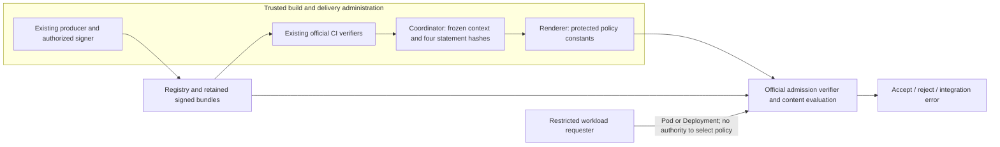

# ADR: select an explicit delivery authorization

Status: **proposed for human approval; implementation and CEL adoption blocked**.
Decision date/reference: **30 October 2026**. Branch:
`design/attestation-selection-contract`. [Spanish explanation](../../ES/maintainers/attestation-selection-contract.md).

## Decision and scope

Recommend **authorizing one concrete delivery against explicitly selected,
authenticated evidence**, using the existing trusted run configuration, CI
verification, renderer and coordinator. Identify each selected statement by the
SHA-256 of its exact signed statement bytes. Do not select by registry order,
arbitrary historical PASS, an opaque ID alone, or greatest timestamp.

The product needs delivery authorization now (A). Continuous reassessment,
automatic supersession and revocation (B) are deferred. A new scan or FAIL in a
registry is not automatically a command to revoke a previously configured
delivery. Changing that decision requires a new trusted preparation. This narrower
claim avoids building an authorization service or promising freshness that the
registry cannot establish. It also deliberately narrows the more ambitious
current-authorization recommendation in PR #65.

**Feasibility outcome:** no inspected official Kyverno release implements the
complete proposed selection contract. The unpublished #18049 selector is not
sufficient either. A signed-subject annotation filter is available and was tested,
but does not resolve conflicting contents with the same identifier. Keep the
active ClusterPolicy path and `golden-path-v1` unchanged. Design approval does not
authorize migration or establish compatibility. The next implementation branch is
`feat/delivery-authorization-selection`, gated by the capabilities and tests below.

This ADR is a product decision proposal, not a security standard requiring all
historical statements to conform. Its model tables are intended oracles for future
implementation; they are not observations of Kyverno.

## Base, references and evidence boundaries

Fetched `origin` and started from main
`e0fbe6490794b0da679777d465117a43bdb482ad`. PR
[#65](https://github.com/tfm-goldenpath/golden-path-lab/pull/65) was still OPEN,
ready for review, at `f553b9eacad6ee6a4eb1ebcc0d8608315dd1793b` on this consultation.
At that initial preparation, no merge or cherry-pick was performed. Its
[canonical investigation](https://github.com/tfm-goldenpath/golden-path-lab/blob/f553b9eacad6ee6a4eb1ebcc0d8608315dd1793b/docs/EN/maintainers/kyverno-cel-migration.md)
and [reproducer](https://github.com/tfm-goldenpath/golden-path-lab/blob/f553b9eacad6ee6a4eb1ebcc0d8608315dd1793b/implementacion/tests/integration/kyverno-cel-capabilities.py)
remain commit-pinned references to the original research. PR #65 subsequently
merged into main as `2b654f94e9c1bbb42ee3a6e75e788bc167407787` at
**2026-10-30T20:19:06Z**. PR #66 now incorporates that main revision to resolve
the TODO overlap, retaining both the completed research record and this proposed
design. The [research document](kyverno-cel-migration.md) and reproducer are now
present in this branch; the original execution provenance is unchanged. After synchronization, the combined
inventory covers **519 tracked paths**; its 10 tests, 174 relative documentation
links, Bash syntax and diff checks pass. Runtime, tests and pins match current main.

PR #65 observed order-dependent **selection of authenticated content** in
1.19.2: same reference and signed bytes, reversed referrers, reject/accept/reject.
That is not signature forgery, acceptance with no conforming results, or a general
vulnerability claim for every Kyverno configuration. The old engine was
characterized with CLI; the candidate CEL engine also received real admission
requests. Those synthetic predicates are not the complete Golden Path contract.
Its executed probe hash was
`226a2ba5f9fbeb301638068af6e67602443f675961cb9c373c144f467d76e9ae`, executed from
`19c1094` plus recorded changes before the later documentation commit. Neither
that execution nor passing CI is attributed to this design branch. Original
results, failed attempts and NOT_EXECUTED cases remain unchanged.

## Product context and authority

The existing [delivery contracts](../../../implementacion/docs/EN/delivery-contracts.md)
and [modular architecture](../../../implementacion/docs/EN/architecture.md) remain
active. The following is the proposed future context, frozen for one preparation:

| Expected value | Trusted source and permitted writer | Admission obligation |
| --- | --- | --- |
| Exact image repository and `sha256` digest | Coordinator resolves the built/published object; authorized operator selects source/configuration | Reject tags, a different repository or subject; no automatic tag mutation |
| Four statement types | Reviewed contract/renderer code | Independent `https://sigstore.dev/cosign/sign/v1`, CycloneDX, SLSA provenance and verification-results; no substitution |
| Local authority | Explicit development public key from the owned run | Same key; local timestamp/log exceptions stay local |
| Hosted authority | Reviewed workflow configuration: exact identity/ref, GitHub issuer and roots | Signature, digest, certificate and transparency verification; anchor/escape any identity regex; never widen to arbitrary branches |
| Source repository/revision | Trusted source selection and captured immutable commit | Exact authenticated source; the received statement cannot choose the expectation |
| Contract and policy version | Reviewed producer/validator/renderer configuration | Exact expected version, never “any known version” chosen by the workload |
| Build type/builder | Existing lane-specific contract | Local build type/builder or exact hosted workflow builder, wherever currently required |
| Selected statement hashes | Existing CI authenticates the exact retained statements; coordinator binds their hashes into the reviewed preparation | Retrieve and authenticate those contents independently at admission, then evaluate all fields on each same statement |
| Namespace/resource/operation | Existing platform configuration | Preserve protected Pod/Deployment CREATE/UPDATE and existing subresource/runtime boundaries |

No new environment/channel dimension is needed: A/B already changes authority and
build contracts. Add one later only if it changes a real authorization decision.
Do not let a workload label choose a more permissive lane, source, policy or hash.

The administrator/authorized coordinator can write policy specifications, trust
and preparations. The deployer can request workloads only. The future binding
must be embedded in generated policy constants, persisted with the run receipt,
and checked against actual API/kind/name/UID/spec/generation where exposed. It is
not a ConfigMap selected by a Pod annotation. No new mutable authority store,
database, ledger, webhook or custom cryptographic verifier is proposed.

An administrator capable of replacing admission policies remains trusted; this
design does not defend against that administrator or a fully compromised authorized
producer. Receipt hashes are custody/binding evidence, not a new signature chain.
The existing official verifiers still establish cryptographic authenticity.



The registry is an untrusted transport and can withhold objects. Authentication is
required on both crossings into trusted evaluation. The requester cannot write
the CI/coordinator/policy boundary. Local administration controls both signer and
cluster; it is a laboratory trust model, not hosted OIDC isolation.

## Options compared

“Applicable” first means authenticated by the required authority, bound to the
image digest and correct statement type. For the proposed selection it additionally
means the exact content designated by trusted configuration; its source/version/
builder must still be evaluated and pass. A recognized other context cannot
supply evidence for this one. PASS is always an outcome to evaluate **after**
selection, never a filter that removes FAIL candidates.

| Strategy | Admission and recovery | Old/contradictory evidence | Cost and official capability |
| --- | --- | --- | --- |
| All authenticated applicable statements conform | Accept a nonempty set only if each complete statement passes; old FAIL can block same-context recovery until the scope or delivered artifact legitimately changes | Reject visible contradictions; cannot discover a hidden FAIL | Small policy, but applicability/history management is difficult. Active legacy CLI characterization checks every matching statement. IVP 1.19.2 and #18049 do not expose all candidates for this contract |
| At least one complete applicable statement conforms | Accept a complete PASS, including recovery after FAIL; reject partial/complementary statements | Old PASS can survive a newer FAIL. Valid only for an explicitly monotonic permission product, not implicit revocation | Simple existential rule if an authenticated collection exists; `verifyAttestationSignatures` count counts successful attestors, not complete statements. No such collection is exposed by inspected IVP |
| **Exact content selected by trusted preparation** | Require the four designated statements, authenticate each and evaluate the whole contract. Recovery uses a newly prepared binding, never a registry-only override | Registry cannot substitute another authentic PASS for an expected different content hash. New unselected results do not revoke a frozen delivery | Four hashes in existing configuration/receipts; no clock or service. Requires official preselection of authenticated exact contents or an authenticated collection. Inspected Kyverno lacks it; filtering an opaque ID is insufficient |
| Current authorization by time and supersession | New authorized FAIL may revoke and new authorized PASS may recover, if trusted rules establish currentness | Visible maximum time is insufficient; equal-time contradiction must be resolved by authority, not bytes | Requires authoritative head/minimum sequence or other trusted state, time-source rules, expiration/skew and concurrency handling. #18049's newest selector supplies only part of this and no rollback protection. Defer B |

## Proposed contract: immutable preparation, exact contents

1. The existing producer creates modern bundles. Existing CI verifies each exact
   bundle, digest, authority and full applicable content contract. For hosted native
   provenance, preserve the exact authenticated statement corresponding to the
   GitHub verifier output. Fail if that association cannot be established.
2. Compute `sha256` over the decoded DSSE **statement bytes**, without JSON
   reserialization, and bind one hash per type and image to trusted preparation.
   This is a content identifier, not a signed assertion that an arbitrary
   `authorizationId` equals a hash. Admission must hash the very bytes it
   authenticated and compare them with the trusted expected value. A hash in an
   OCI annotation or an unvalidated signed field is insufficient.
3. After authentication, select exact expected content, independent of retrieval
   order. Re-signing identical bytes need not create a new authorization; different
   serialized bytes need a new explicit binding even if their JSON is equivalent.
   Other contents are not fallback authorizations. Selection must not discard
   FAIL because of its outcome. Duplicate exact content has one meaning.
4. Evaluate the selected complete statement. Results require exact source and
   policy version, `result=PASS`, and all seven existing PASS checks: `unitTests`,
   `manifestPolicy`, `workflowPolicy`, `vulnerabilityPolicy`, `signature`, `sbom`,
   `provenance`. Neither fields nor checks may be assembled across statements.
   Keep the independent sign/v1 requirement, CycloneDX conditions/full-schema CI
   boundary and existing provenance source/build requirements.
5. All four independently required statements must succeed. Choosing specific
   SBOM/provenance contents does not give them results-style temporal supersession.
   Inventory completeness remains a CI/laboratory property; admission is not proof
   that every object in the registry was retrieved or that an SBOM is exhaustive.
6. No binding yet, missing selected content, failed cryptography, registry/auth/
   network errors or invalid policy stop protected delivery. Report the actual
   cause; failure to retrieve is not proof of absence. Existing F07/F08/F13
   attribution must eventually cover every admitted representation and retain
   original diagnostics. A generic Kyverno failure does not identify the object
   it authenticated.
7. Bindings are immutable for a prepared laboratory. Serialize configuration and
   delivery using the existing coordinator ownership model. Reject resume after
   an unexpected source, trust, policy or binding change. Initial and replacement
   images each need their own complete binding. Do not install a partially prepared
   allow path while results have not yet been issued.

No new `authorizationId`, sequence, issuance or expiry field is required for A.
This avoids pretending that an editable annotation is authority or that a signed
sequence alone prevents rollback. The annotation experiment below evaluates an
alternative, **not** the proposed exact-content guarantee. Conflicts in opaque IDs
are not resolved by assigning lexicographic precedence. If a future implementation
uses IDs instead of content hashes, it needs separate authenticated uniqueness and
conflict enforcement; that is outside this recommendation.

Modern bundles remain the canonical generation, CI verification and custody
format. An official admission representation may be used only after demonstrating
all four guarantees, same authenticated-content association and the full decision
matrix. A conventional classic image signature is not an in-toto sign/v1 DSSE
statement. Classic storage of DSSE is another case. Neither lookup nor a local
timestamp-free failure establishes hosted/classic support. Preserve the format
decision in PR #65 and require new tests before admitting another representation.

This is a **semantic contract change**, even if existing statement fields can be
reused: old unrelated matching statements would no longer veto a specifically
selected authorization. Reserve a reviewed successor policy version (proposed
`golden-path-v2`) and a versioned preparation/binding receipt for implementation.
Do not reinterpret `golden-path-v1` or change its bytes, producer, schema, policy
version or historical evidence in this branch. A new predicate URI is needed only
if the reviewed statement schema changes; changing the policy version is not an
automatic reason to replace the current results predicate URI.

## Decision table for future implementation

`ACCEPT` assumes safe runtime input and all unrelated controls pass. `REJECT`
means a demonstrated mandatory-content violation. `ERROR` blocks delivery but
does not count as scenario detection. `LIMIT` is a guarantee outside A, not a test
pass. All rows are **proposed expectations**, except executions explicitly reported
later. E is the trusted expected content binding, not a value supplied by the Pod.

| Context and input | Expected decision | Reason / required test |
| --- | --- | --- |
| Complete conforming selected statements for all four types | ACCEPT | Authenticate, exact byte hashes, full same-statement fields |
| Selected sign/v1 absent, other three present | REJECT if absence established; otherwise ERROR | SBOM/results signatures cannot replace independent image signature |
| Selected SBOM absent | REJECT/ERROR as above | No provenance/results substitution |
| Selected provenance absent | REJECT/ERROR as above | No source assertions from another type |
| Selected results absent | REJECT/ERROR as above | No deployment before complete authorization |
| Wrong digest, signer, identity, repository, revision, builder or policy | REJECT when isolated and established; verification ambiguity is ERROR | Valid cryptography alone cannot authorize a different context |
| Identical authenticated duplicates of E | ACCEPT | Same statement bytes; no new decision or renewed lifetime |
| Distinct conforming statements, one equals E | ACCEPT in both orders | Only designated complete content authorizes; absence of E blocks even if another PASS exists |
| Contradictory statements in both orders; E designates FAIL | REJECT both | Outcome evaluated after selection; old PASS cannot substitute |
| Contradictory statements; E designates PASS | ACCEPT both under A; LIMIT for automatic revocation | Selected permission remains until trusted preparation changes; explicitly not current-by-registry semantics |
| Old PASS then later FAIL, no trusted configuration change | Same decision under A; LIMIT | Neither visibility nor timestamp grants authority to change the binding |
| Old FAIL then operator-approved recovery with new E/PASS and complete independent evidence | ACCEPT only in fresh prepared environment | Same-digest recovery needs new binding; preserve failed preparation. Unapproved registry PASS cannot recover |
| Dates absent, future or equal in results | Do not select by them | A has no lifetime claim. Existing certificate/transparency validity still enforced; future invalid crypto evidence blocks |
| Same opaque ID/sequence, contradictory contents | Content hashes distinguish them; select only E, never the ID/sequence | If trusted configuration assigns two hashes to one required slot, ERROR. If an ID-based alternative cannot reject ambiguous duplicates, it is not an implementation of this proposal |
| Another source or policy version beside E | Cannot substitute; ACCEPT only if E itself satisfies configured context | Unknown versions in selected content reject; changing context requires trusted preparation |
| Complementary statements, neither complete | REJECT | Never combine seven checks or source/build fields across statements |
| Registry hides newer FAIL, returns selected old PASS | ACCEPT under unchanged E; LIMIT for automatic freshness/revocation | If administrator changed E to newer content, hidden E blocks; registry cannot roll E back |
| Partial publication of four selected contents | REJECT only for established absence, otherwise ERROR | No temporary exception while publication completes; retry after fresh complete verification |
| Concurrent change of expected authorization/policy | ERROR at coordinator boundary; retire affected preparation | No cross-policy atomic transaction claimed; use isolated fresh environment, serialize authorized changes and confirm actual specs/probes before deployment |
| Cached success after trust/context/policy change | Must not authorize changed preparation | Keep verification cache disabled initially; demonstrate fresh retrieval and unchanged specs, plus manipulated workload annotation negatives |
| Malformed/invalid required bundle or unavailable registry credentials/network | ERROR, or isolated verified cryptographic rejection | No alternate representation may omit a required check; do not report a missing-evidence detection from a transport/certificate error |

## Security limits and state

The only additional trusted state for A is the frozen binding in existing run
configuration and generated policy specs. The authorized coordinator maintains it;
the workload actor has no write privilege. If binding validation/readiness is
unavailable, stop delivery. Policy absence or webhook bypass remains a platform
failure requiring existing availability/RBAC protections; a saved receipt cannot
enforce admission by itself.

The registry can withhold a later authentic decision. The newest visible date and
Rekor inclusion cannot prove that no later authorization or revocation exists.
A signed sequence needs an independently known minimum to prevent rollback.
Expiration only bounds replay and does not provide immediate revocation. A
byte-based tie-break is deterministic but does not decide whose authorization
prevails. These are reasons to defer B rather than invent clocks or a ledger.

Changing policies denies subsequent admissions; it does not evict running Pods.
Kubernetes/controller propagation and in-flight requests are not a linearizable
revocation protocol. A frozen preparation may continue authorizing its original
contents until the trusted operator retires it; the product must not call this
continuous security reassessment. An administrator intentionally restoring an old
binding can authorize old contents. There is no autonomous anti-rollback state.

Future B would need approved authoritative head/supersession state, atomic update
semantics, expiry/skew/time-source rules, cache invalidation and an explicit policy
for existing workloads. None is created by this ADR. A runtime-only migration to
ValidatingPolicy could be a separately justified increment, but retaining legacy
image verification still depends on ClusterPolicy and does not solve its removal.

## Official support and implementation inspected

Direct GitHub release/PR consultation began **2026-10-30T19:27:59Z**; pinned
source retrieval completed **2026-10-30T19:28:59Z**. Artifact checks followed on
the same UTC date; support/migration/schedule pages were also captured directly at
**19:45:43–19:45:44Z**. Commands, raw responses and hashes are retained in the small
design evidence package, without credentials:

```bash
gh api repos/kyverno/kyverno/releases/latest
gh api 'repos/kyverno/kyverno/releases?per_page=20'
gh api repos/kyverno/kyverno/pulls/18049
```

| Official source | Checked result and practical consequence |
| --- | --- |
| [Latest release API](https://api.github.com/repos/kyverno/kyverno/releases/latest), [20-release inventory](https://api.github.com/repos/kyverno/kyverno/releases?per_page=20), [v1.19.2](https://github.com/kyverno/kyverno/releases/tag/v1.19.2) | Latest stable remains **1.19.2**, published 20 October. No newer release/RC with the selector was identified; publication after a merge does not imply inclusion |
| [Community patch support](https://kyverno.io/docs/installation/releases/#community-patch-support) | Supported branch **1.19**, critical bugs and high/critical CVEs; Kubernetes **1.33–1.35**. Support ends at 1.20 release, estimated November, not a confirmed calendar day. 1.19 is not declared unsupported on 30 October |
| [Migration guide](https://kyverno.io/docs/guides/migration-to-cel/) and [API schedule](https://kyverno.io/docs/policy-types/overview/#deprecation-schedule-for-legacy-types) | ClusterPolicy deprecated in 1.19, removal announced for 1.20; stable CEL `policies.kyverno.io/v1`. General feature-parity documentation is not evidence of our selection contract |
| [Official chart index](https://kyverno.github.io/kyverno/index.yaml) | Chart **3.9.2**, appVersion **v1.19.2**, archive SHA-256 `f6fe7184544d5e2ee33a77808c09e67aa603ce6560cc197038fde31d727c861e`; retained archive matches index/lock. Chart's permissive Kubernetes minimum is not the tested support matrix |
| Existing platform/pins | Controller and CLI **1.19.2**, chart **3.9.2**, Kubernetes **1.35.8**, Helm **4.3.1**, Cosign CLI **3.1.4**. Kubernetes is inside the documented range. Prior integrations are linked through #65/main maintenance records; no new full platform integration here |

Reviewed final [#18049](https://github.com/kyverno/kyverno/pull/18049), merged as
`edd8b239e393a611137a5d466d12cdc416331224` on 17 October, and re-fetched the
[release verifier](https://github.com/kyverno/kyverno/blob/v1.19.2/pkg/image/verifiers/ivpol/cosign/verifier.go),
[merge verifier](https://github.com/kyverno/kyverno/blob/edd8b239e393a611137a5d466d12cdc416331224/pkg/image/verifiers/ivpol/cosign/verifier.go)
and [timestamp implementation](https://github.com/kyverno/kyverno/blob/edd8b239e393a611137a5d466d12cdc416331224/pkg/image/verifiers/ivpol/cosign/timestamp.go).
New main `a6ff05d62e1f23833afacbe94256fb02c0f989f7` still has identical
verifier/timestamp bytes to that merge. Release branch
`302ab28f3877e04cfa2b8de5995ea98f3cfda357` still has the 1.19.2 overwrite loop
and no timestamp file; path history shows no equivalent backport. Merge versus
v1.19.2 is diverged (98 ahead / 279 behind). Reuse #65's older-tag inspection for
1.19.0/1.19.1/1.19.2-rc.5; it is not newly executed here.

The 1.19.2 verifier file SHA-256 is
`808531702f1cdf4fdcb5f28c4612a8e900b5debfdb7cdb9e773c1e88933cdafa`;
merge/main timestamp file is
`c6028aa964059aa9cdc312ff5a78501238493218d4c3752729a2097f8df5700d`.
The fix is in development source, **not an identified published release**. Its
future inclusion would still require contract validation, not automatic adoption.

Artifact checks go beyond tag dates:

- Rechecked official CLI archive against freshly retrieved published checksums:
  `357eaf1df8bc24ddd5a73979fadeaae6a032e8710f11af264229756e4956bf4a`.
  Its member matches installed binary
  `dd492a230e3f7c68235efbf925932cdb34cefbabbd4436d932c3287d9450eea8`.
- Read the pinned official controller OCI index
  `sha256:c8c4dd09e720d2cd7fd24ca73ac28e46651001372f988e0cba3f2f612f04b955`,
  amd64 manifest
  `sha256:6f0c520054d863a4a3df53ac7bb67d571d20421b77b99809013a62ec5f1d5947`
  and content-addressed binary layer. `go version -m` on the extracted controller
  (without executing it) reports Cosign **3.1.2**, sigstore **1.10.9**,
  sigstore-go **1.3.0**, Rekor **1.5.3**, rekor-tiles/v2 **2.3.0**, matching the
  CLI build and release dependencies. Controller binary SHA-256:
  `7913082b95920ca27f3490a80c5fe63fc5b0b894d2aab5791e16b2a1f044f7b3`.
- Both official binaries report revision
  `e63308f1e16c05cd009ac4864be6ec25c66b49be` and `vcs.modified=true` in their
  publisher build metadata. This is not a local build/fork. Temporary controller
  layer/binary files were removed; their hashes/build metadata remain.
- #18049 merge dependencies instead use Cosign **3.1.3**, sigstore **1.11.0**,
  sigstore-go **1.3.0**. Updating our Cosign CLI to 3.1.4 did not update the
  controller's verifier. Pins remain untouched in this branch.

### What the official functions do, and what is missing

`VerifyAttestationSignature` authenticates candidates and image subject before
calling `AttestationToPayloadJSON`. In 1.19.2,
`AddVerifiedIntotoPayloads` overwrites the payload for a predicate type.
`verifyAttestationSignatures(image, attestation, attestors)` returns an attestor
success count; `extractPayload(image, attestation)` returns one selected payload.
Neither is an API for all authenticated statements or an exact statement-hash
selector. See the pinned
[CEL function declarations](https://github.com/kyverno/kyverno/blob/v1.19.2/pkg/cel/libs/imageverify/lib.go),
[implementation/cache](https://github.com/kyverno/kyverno/blob/v1.19.2/pkg/cel/libs/imageverify/impl.go)
and [API types](https://github.com/kyverno/api/blob/fb2785727f98/api/policies.kyverno.io/v1alpha1/imagevalidating_policy.go).
`source.repository` changes retrieval location, not authenticated selection by
content hash. `attestations.intoto.type` chooses a predicate, not an authorization.
Comparing fields *after* overwrite can fail closed on a wrong selected statement,
but does not provide order-independent acceptance of the designated valid one.

`cosign.annotations` becomes the expected map passed to
[`IntotoSubjectClaimVerifier`](https://github.com/sigstore/cosign/blob/v3.1.2/pkg/cosign/verifiers.go).
It compares annotations **inside the signed matching subject**, after bundle
authentication, before adding candidates. This is a useful official context
filter, not a mutable Pod annotation. However, two different statements can carry
the same authenticated annotation. It neither computes a content hash nor proves
unique ID assignment. A signed `contentHash` field is also only an assertion until
the verifier compares it with the same authenticated bytes. Do not use it as a
substitute for that missing comparison/selection capability.

The final #18049 implementation changes selection, not the exposed interface:

- Associates each successful signature with its same verified bundle/result;
  deduplicates identical extracted payload bytes and retains available/later times
  for identical payloads. Selection groups by image/predicate, not our full
  authority/source/policy context. Request-scoped candidate storage also merges
  across attestors/evaluations; it is not per-authority isolation.
- A singleton needs no time. Multiple distinct candidates use bundle times if
  **all** have them, otherwise statement times if **all** have them, else fail for
  lack of a common source category. Latest wins; equal times choose the
  lexicographically greatest payload bytes, including contradictory decisions.
  It does not expose every statement or reject every semantic conflict.
- Bundle times first come from the corresponding verification result's earliest
  nonzero `VerifiedTimestamps`. The helper does not inspect the timestamp type;
  some sigstore-go configurations can report verifier `CurrentTime`. Association
  fallback compares envelope/payload with the same bundle, tries verified log or
  RFC3161 timestamps, and includes a raw integrated-time fallback relying on prior
  authentication. Classic DSSE uses verified-signature-associated Rekor or TSA
  material. Bundle time is not necessarily the producer's decision time, nor a
  common trusted clock across every candidate.
- Statement time is an authenticated author assertion: first parseable recognized
  string in predicate metadata, run metadata, creationInfo, predicate/top-level
  date fields, including build/scan start/finish. It accepts RFC3339 and some
  zone-less layouts, not numeric epochs; it does not choose the maximum of all
  fields. No future-date bound, TTL, minimum sequence or revocation state is added.
- Timestamp-free local keys use Cosign's no-observer profile; distinct results
  without usable times would fail even if both conform. Hosted trusted log/TSA
  proofs can enable newest selection. Identical duplicates can be a singleton in
  either lane. These patched-engine conclusions are **source analysis**, not CLI,
  admission or hosted execution. Detailed time-source references remain in #65.

The cache in released IVP includes attestor material/policy-derived keys and can
restore authenticated payloads. It is a different path from legacy caching.
Do not infer invalidation of every trust/context change from key design. The first
implementation must disable it explicitly and prove fresh behavior; re-enabling
requires its own context/rotation/staleness tests. Workload annotations cannot
replace verification even when they resemble an engine receipt.

## Bounded new feasibility experiment

One uncertainty could change the decision: whether the official signed-subject
annotation filter could supply exact authorization selection. Reused PR #65's
hash-pinned `Probe` in an **ignored evidence adapter**, without copying its commits
into this branch or adding another production/test entry point. It used the
existing registry, signing, order proxy, evaluation-count checks and cleanup;
no Kubernetes cluster was created. CLI 1.19.2, Cosign 3.1.4, timestamp-free local
key, new image/bundles, disabled CLI verification cache. The four synthetic
predicate checks remain independent. Only results uses a second attestor with:

```json
{"name":"selected","cosign":{"annotations":{"golden-path.dev/authorization-id":"expected"}}}
```

This fragment omits the required key/trust configuration; it is an explanation,
not an installable policy. Raw statements were signed with official
`cosign attest-blob --statement`, not a custom cryptographic implementation.
The statement's matching subject contains that annotation; `authorized` is in
the signed predicate. These are synthetic fields, not golden-path-v1 results.

| Inputs / intended ID-filter oracle | Official CLI observation |
| --- | --- |
| Expected-ID PASS; other three required types valid | ACCEPT, one evaluation |
| Wrong-ID PASS only, or no ID | REJECT in each case; filter-specific fixture evidence, no F07/F13 attribution claimed |
| Expected-ID PASS plus other-ID FAIL, both orders on the same reference | ACCEPT / ACCEPT |
| Expected-ID FAIL plus other-ID PASS, both orders | REJECT / REJECT |
| Expected-ID PASS and FAIL sharing the ID, both orders; intended conflict rejection | REJECT / **ACCEPT**: opaque-ID alternative fails |

Run `annotations-02`: nine evaluated observations, no skipped resources or engine
errors. Test execution **COMPLETED**, filter capability observed, conflict-contract
evaluation **FAIL**, migration adoption **BLOCKED** (exit 2). This is not a new
execution of the proposed hash-selection contract and not real admission.
Referrer order alone changed within each paired case; request and immutable
manifest/blob hashes were checked. Image digest:
`sha256:704717fe31296e1e64a8ce6fe21161b00c9350bf0673f7d49e2e08da776ef331`.
The executed adapter SHA-256 is
`79b264454129a8541e55b773e1e10a4476d175851aaa4943626484949edd3d9f`;
it imported the reference probe hash recorded above. Execution preceded the design
commit, from base `e0fbe64` with an ignored adapter and uncommitted documentation.
The actual code/lock identities are retained in `source.json`; no execution of a
later commit or an implemented hash selector is inferred.

Preserve `annotations-01` as a test-adapter **ERROR** before engine evaluation:
`cosign attest` did not consume a raw statement, and an overly case-sensitive
cleanup assertion obscured that error. The container was removed and absence
logged. The corrected adapter uses `attest-blob` and checks the owner label and
case-normalized absence diagnostic. These failures are not control detections.

The retained adapter accepts `--reference-probe` and `--output`, asserts the exact
reference probe hash above and refuses an existing output directory. Reproduction
uses that file at its normal path in a checkout of the referenced commit, pinned
tools on PATH, and the adapter from the retained package. It creates only an owned
temporary local registry and removes it. Normal delivery/demo commands neither
reference nor install any of these research fixtures. Do not rerun the full #65
matrix merely to confirm this already isolated limitation.

| Evidence level | This branch's claim |
| --- | --- |
| Official source/history/artifact inspection | Completed, exact references above |
| Proposed model/decision table | Design reasoning only; no test that merely repeats the prose |
| Official CLI | Nine new synthetic signed-ID-filter observations; full hash-selection contract NOT_EXECUTED |
| Actual admission | NOT_EXECUTED here; #65 observations retain their original boundary |
| Hosted exact identity/certificate/transparency | NOT_EXECUTED for this contract; existing legacy runs do not validate it |
| Full delivery/demo/vulnerability suite and campaign | NOT_EXECUTED here; no new runtime implementation to validate |

## Implementation gate, fallback and reversal

**Current exit: the proposed contract is not implementable with the inspected
maintained Kyverno APIs.** This is bounded to the inspected releases and main,
not a claim about all future versions. #18049 is unpublished and insufficient;
waiting only for its release is not an implementation plan. Approve A's scope
and oracle independently, then require an official capability to select the exact
authenticated statement (or expose a collection plus same-byte hash binding)
before starting runtime implementation. Never construct a fork, custom crypto,
verification webhook, ledger or another authorization service to fill the gap.

The 2 November 2026 review is **upcoming**, not overdue on this consultation date.
Recheck sooner if 1.20 is released. The already existing reminder for
30 November 2026 at 09:00 Europe/Madrid is unchanged; it is neither the confirmed
retirement date nor permission for automatic upgrades. No automatic policy removal
or update is configured.

One bounded maintained alternative is worth evaluating if an official Kyverno
route is unavailable before support ends: **Sigstore policy-controller for image
evidence, with Kyverno ValidatingPolicy for runtime controls**. Its
[official overview/API guidance](https://docs.sigstore.dev/policy-controller/overview/)
documents key/keyless authorities and attestation policy evaluation. That is an
evaluation candidate, not demonstrated support for our exact selection contract.
It adds a second maintained admission component and policy language/inventory,
so prefer Kyverno if it gains the needed official capability. Before selecting
this alternative, pin a supported release and test same-byte selection, sign/v1
independence, modern bundles, GitHub trust, errors and both orders; review tag
resolution defaults against our tag rejection requirement. Stop the replacement
if any mandatory property cannot be implemented. No engine substitution is made
here. No second alternative or platform expansion is needed for this decision.

The next PR, `feat/delivery-authorization-selection`, must be bounded as follows:

1. **Entry gate:** human approval of the new semantic version/scope and a small
   official-version proof of exact-content selection, including contradictory
   contents and independent authorities, with the expected binding from trusted
   configuration. Release notes or #18049's closure alone cannot satisfy it.
2. Reuse `context.sh` for frozen bindings; `attestations.sh`,
   `verified-bundle-statement.mjs`/`github-attestation.mjs` for association of exact
   already-authenticated bytes; `lab-contracts.mjs` for versioned content checks;
   the renderer for literal expectations. Hashing/selection is not a new verifier.
   Keep workflow YAML as orchestration and avoid adding producer timestamps or
   authorization-service infrastructure.
3. Adapt readiness stages (`initial`, `update`, `prepared`, `authorized`), explicit
   resource inventories, RBAC, snapshots, diagnostics and historical readers.
   Protect preparation/binding/policy writes from the deployer. Preserve original
   diagnostics and errors distinct from attributable rejection. Review F07/F08/F13
   inventories across every enabled representation before changing their readers.
4. Verify the complete decision table with official CLI and real admission, then
   Pod/Deployment CREATE/UPDATE, oldObject, init/ephemeral containers, namespace
   boundaries, tag rejection, legitimate L06, annotation bypass and cache cases.
   Full independent contract/cryptography tests must precede fresh sequential
   delivery/demo/vulnerability integrations and independently verified L01.
5. Require a newly authorized hosted run on the exact candidate SHA, both native
   provenances, four evidence types, exact branch identity/certificates/transparency,
   implemented negative cases and recovery. Unsupported hosted negatives remain
   NOT_EXECUTED. No hosted run is dispatched merely for this design.

Cost: four small hashes per image and versioned receipt/configuration plumbing
reuse existing modules. Most work is official-engine capability validation,
availability/diagnostics and regression of the four independent controls; it is
not a one-line API rename. Exact-byte binding makes reserialization/re-signing
behavior explicit and requires deliberate fresh preparation for changed contents.
No time service or perpetual authorization database is needed for A.

Reversal in this branch is documentation-only. For a future implementation,
retire its owned laboratory using the existing validated-ownership cleanup,
preserve the package, and prepare a **separate fresh environment** at the previous
revision/pins/contract. Do not edit a sealed preparation, reinterpret v2 as v1,
mix ClusterPolicy and CEL as a success proof, or downgrade a live production
cluster. Restoring an earlier revision after community support ends is a recovery
experiment, not a supported long-term operating recommendation.

## Validation and custody for this design branch

Initial design validation: documentation relative links (170 checked), Bash block syntax and explanatory JSON
parse checks pass; the ownership inventory covers **515 tracked paths** and its
**10 existing tests pass**. `git diff --check` passes. The six tracked changes are
this EN/ES ADR, both navigation indexes, TODO and inventory. Production policies,
producers, workflows, tests, pins and historical records are byte-identical to the
base. No new executable is installed from the normal delivery/demo entry points.
Shared CI runs on the final PR SHA; its actual status belongs in the PR checks,
not in an inferred claim of contract feasibility. No redundant full local suite
or hosted workflow was dispatched for documentation-only tracked changes.

The sequential CLI experiment and subsequent read-only artifact inspection stayed
within **4 cores / 16 GB RAM / 32 GB disk**, with 9.1 GiB initially and 9.0 GiB
finally available on the workspace/Docker filesystem, over 1.69 million free
inodes and the 3 GiB reserve preserved. No Kubernetes was created. Both owned
registry containers were removed with absence confirmed; temporary keys and the
controller layer/binary were removed. Three pre-existing images and three inactive
volumes remain unchanged. No vulnerability DB, historical image or archive was
copied/pruned. Foreign root npm files and the #65 worktree remain untouched.

Compact retained package (ignored, outside Git):
`implementacion/evidence/packages/attestation-selection-design-e0fbe64-20261030.tar.gz`,
**849,839 bytes / 180 entries**, SHA-256
`42caf36666c2fea6d0bd60c9c9b1361e893dec3534b2a73bf7b6141148e2b47d`.
Every archive entry and its SHA256SUMS was compared with original retained bytes.
It contains sources/release/artifact receipts, the reusable reference probe and
small adapter, public synthetic bundles, both attempts, original diagnostics,
order/byte checks and cleanup receipts. It excludes credentials, private keys,
controller binaries/layers, vulnerability DBs and previous archives. The local
package is custody evidence, not a remotely published release asset.

AI assistance: OpenAI Codex performed source inspection, the bounded experiment
and documentation. Human review/design approval remain **pending**. No merge,
release, upstream issue/comment, scheduler change or policy migration was performed.
