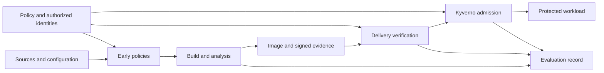
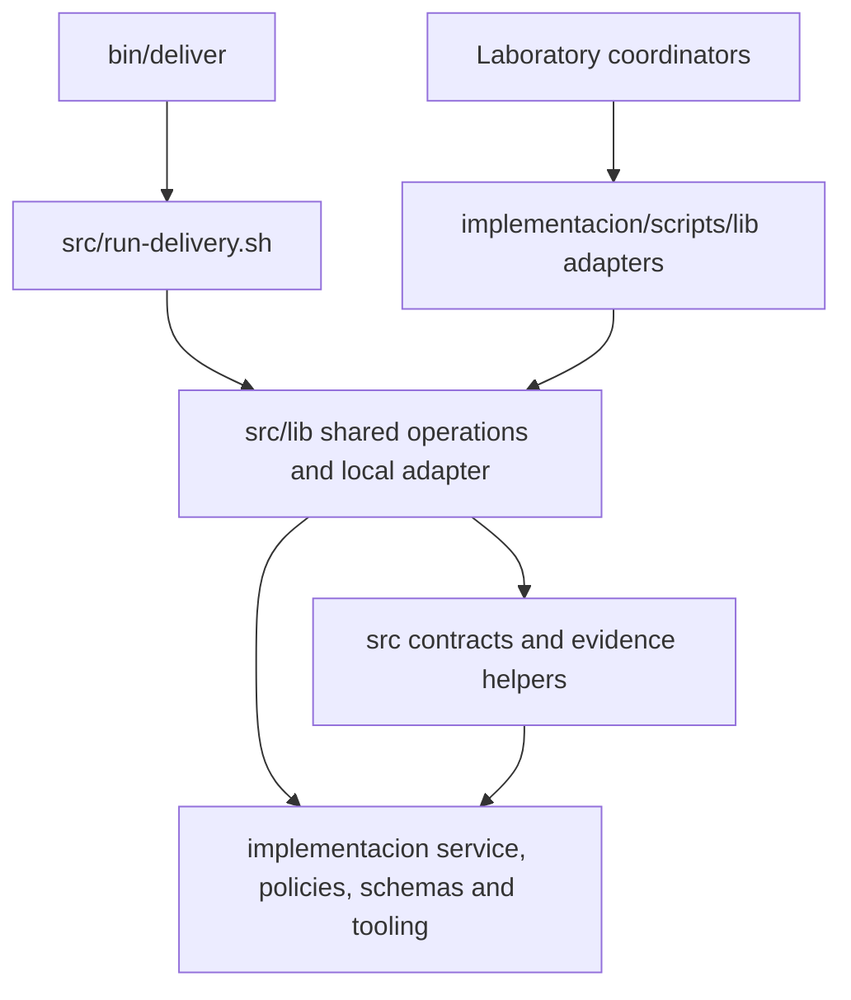

# Modular architecture of the Golden Path

[English documentation](README.md)

[Versión en español](../ES/architecture.md).

## Local delivery and laboratory boundary

The available local quotes-node path enters through `bin/deliver` and uses the
shared engine in `src/`. Laboratory coordinators consume that engine through
adapters. This is one separated path, not the whole repository. Start with the
[operator guide](../../../docs/EN/legitimate-delivery.md); the
[module table and contract](#implemented-modules-and-dependencies) below describe
canonical ownership, internal paths and compatibility.

## Design decision and rationale

The implementation uses a **modular architecture for automation, policies and evidence, with separate delivery and laboratory coordinators**. Modules group responsibilities and define how components communicate and are tested. Makefile and workflows invoke common commands. `bin/deliver` coordinates the extracted `src/` engine; `scripts/demo.sh` coordinates laboratory adapters in `scripts/lib/`, the same shared engine and `tests/scenarios/`. Policies, validation and packaging keep specialized components. Admission rechecks applicable conditions before protected Kubernetes workloads are created or updated.

This describes the selected organization, not a new architectural standard. [NIST SP 800-204D](https://csrc.nist.gov/pubs/sp/800/204/d/final) discusses supply-chain controls across CI/CD. [Tekton Tasks and Pipelines](https://tekton.dev/docs/pipelines/) illustrate task composition with inputs/outputs, while [Konflux Enterprise Contract](https://konflux-ci.dev/architecture/core/enterprise-contract/) separates building from policy-based attestation verification before release. These precedents support separated responsibilities without requiring those platforms in this laboratory.

A practical rule is that a check should be understandable and testable without reading the entire workflow. Automation coordinates tools; policies express acceptance conditions; evidence links an artifact to those conditions. R and G preserve the same API and image during the demonstration, isolating functional effects of controls. Architecture alone does not establish reduced time or cost; those are evaluation questions.

## Responsibilities and boundaries

| Component | Responsibility | Boundary |
|---|---|---|
| `quotes-node` | Deterministic synthetic API; separate HTTP, validation and calculation. | Not an insurer's production system or actuarial model. |
| Orchestration | Order tasks, pass parameters/results, stop protected steps and preserve evidence. | `src/run-delivery.sh` owns local delivery sequencing/cleanup; `demo.sh` owns laboratory sequencing/cleanup. Each execution has one cleanup `trap` and shared module context. |
| Early policies | Conftest configuration checks and laboratory rules over scanner reports. | Accepted configuration does not prove later image integrity. |
| Build and analysis | Build, identify by digest and generate Trivy inventory/report. | The report must refer to the delivered object; an unchecked rebuild is insufficient. |
| Evidence and trust | Produce, sign, retrieve and verify evidence; relate subject, issuer, execution and policy. | Valid signatures alone do not prove absence of vulnerabilities or malware. |
| Admission | Kyverno rules for applicable operations in the protected namespace. | A summary does not replace agreed direct checks. |
| Evaluation | Prepare scenarios, record observations and classify results under the protocol. | Do not alter control decisions to manufacture favorable results. |

The catalogue's six blocks classify evaluated properties. They are not six microservices or six deployable modules: SBOM checks, for example, involve production, verification and admission.

## Flow and verifiable contracts

A **contract** defines what one component passes to another and what the consumer must check. It covers meaning as well as format: valid JSON naming another digest does not satisfy the delivered-image contract.

Arrows describe data/control dependencies, not a requirement to serialize every independent task.

| Contract | Minimum information and checks |
|---|---|
| Image | Digest reference, `linux/amd64` and correspondence between scanned, signed and deployed objects. Distinguish OCI index and manifest when both exist. |
| SBOM | Original CycloneDX JSON plus Cosign attestation. CI validates official CycloneDX 1.7 draft-07 schema and lab content, then checks expected type, signature and image association. Kyverno checks selected fields; authenticity does not prove completeness. |
| Vulnerabilities | Separate report with identifiable subject, scanner and database. Block HIGH/CRITICAL regardless of fix availability; retain incomplete-scan diagnostics. |
| Image signature | Validity, artifact correspondence and trusted identity. Constrain OIDC issuer/identity in B and configured development trust in A. |
| Provenance | Signature, trusted identity, digest, source repository/commit and required builder/workflow. Generating provenance does not automatically establish an SLSA level. |
| Results attestation | Versioned custom predicate inspired by VSA; identified policy, origin, outcome and evidence references, bound to the digest through in-toto. Issue successful authorization only after all mandatory prior checks pass; verify authenticity, type, version, outcome and required policy. |
| Control decision | Distinguish acceptance, rejection for an identified condition and inability to decide. Preserve rule/cause/identifiers. An error in a mandatory control stops the protected step. |

The summary is not presented as a conformant VSA implementation. [VSA](https://slsa.dev/verification_summary/v1) is the conceptual reference; [delivery contracts](delivery-contracts.md) specify implemented formats and checks.

Conftest uses Rego while Kyverno uses declarative resources. Shared properties require consistent valid/invalid inputs and expectations adapted to each consumer. The tools do not execute the same file, and not every early rule has an admission duplicate. References: [Conftest](https://www.conftest.dev/), [Kyverno image verification](https://kyverno.io/docs/policy-types/cluster-policy/verify-images/).

## Execution lanes and configurations

**Lane A** runs in the devcontainer with kind, zot and development signing. `make demo` directly invokes `demo.sh`; `act` additionally exercises compatible workflow steps. **Lane B** uses Actions, GHCR, real OIDC and keyless signing to validate hosted integration and identity. Reuse analysis commands where practical while keeping publication and trust configuration distinct.

**R/G** identifies the control configuration; **A/B** identifies execution environment and trust. A local rule test does not establish hosted OIDC behavior. Root `.github/workflows/` refers to `implementacion/`: CI runs on PR/push, while B uses manual `workflow_dispatch`, not yet reusable `workflow_call`. Historical [validation records](../../registros/validacion_integracion.md) describe their recorded scope. The [runbook](cases/L01-F13/runbook.md) distinguishes the successful classic hosted image-replacement run from the bundle candidate, whose local strict-retrieval compatibility run passed. Local directed F07 subsequently passed in `run-xFGRe6X1`; its [record](cases/F07/record.md) retains source hashes and limitations. Hosted F07 remains pending; earlier hosted OIDC/SCT/transparency observations are documented in the runbook.

The laboratory interfaces are `make demo` and `make reference`; the ordinary local delivery entry is `bash bin/deliver local`. GitHub retains **prepare → actions/attest → finish → cleanup**: preparation produces the initial and L01 replacement images with separate state; two hosted action steps issue native provenance for their respective digests. Finalization verifies each delivery and cleanup removes shared resources. A local function does not substitute for the hosted attestation action.

## Implemented modules and dependencies

Paths are relative to the repository root. These are modules in **one Bash
process per execution**, sharing variables and functions; they are not isolated
services or security boundaries. Imports define functions without provisioning
resources, using the network or starting scenarios.

| Canonical implementation | Operations and boundary |
| --- | --- |
| [`bin/deliver`](../../../bin/deliver) → [`src/run-delivery.sh`](../../../src/run-delivery.sh) | Small entry → fixed local sequence, fresh execution and sole delivery cleanup/finalization owner. |
| [`src/lib/context.sh`](../../../src/lib/context.sh) | `context_init`, state creation/loading, `get`/`put`, committed-source capture/recheck, stage receipts and packaging. |
| [`src/lib/delivery.sh`](../../../src/lib/delivery.sh) | Service/workflow checks, captured build inputs, image publication/digest, manifests, original SBOM and vulnerability analysis/policy. |
| [`src/lib/attestations.sh`](../../../src/lib/attestations.sh) | Lane-specific trust, separate image/SBOM/provenance verification, fresh registry gate and results authorization. Authenticate before accepting fields. |
| [`src/lib/workload.sh`](../../../src/lib/workload.sh), [`admission.sh`](../../../src/lib/admission.sh) | `workload_deploy`, rollout, effective image and HTTP observations; strict admission diagnostic classification. A healthy response is separate from admission. |
| [`src/lib/local-environment.sh`](../../../src/lib/local-environment.sh), [`local-delivery.sh`](../../../src/lib/local-delivery.sh) | Neutral kind/zot/buildx, namespaces, `k`/restricted `actor`, policy/controller readiness and diagnostics; delivery `environment_*` adapter adds capacity, immutable ownership receipts and retirement. No import of `lab.sh`. |
| [`src/` helpers](../../../src/) | `contracts.mjs` generates/checks content; bundle/GitHub helpers interpret authenticated content; source/build capture, schema checks, archive writer and verifier handle evidence. Field validation and inventory inspection do not authenticate signatures. |
| [Laboratory adapters](../../scripts/lib/), [`demo.sh`](../../scripts/demo.sh) and [scenarios](../../tests/scenarios/) | Reuse the engine; retain lab source/fixture selection, reference behavior, scenario mutations/readiness, measurement/manual hooks and lab cleanup/packaging selection. Old script paths delegate to canonical helpers. |
| [Service](../../services/quotes-node/), [policies](../../policies/), [schemas](../../schemas/) and [tooling](../../tooling/) | Explicit retained inputs under `implementacion/`, alongside `versions.env` and `tools.lock.json`. The service does not import the delivery engine. Policies keep their distinct Conftest/Kyverno implementations. |

Arrows show dependency direction. Product execution does not load the laboratory
adapters. Compatibility includes `bash implementacion/scripts/deliver.sh local`,
its cleanup command and `make -C implementacion deliver`; they reach the same
engine. Historical classic-chain support remains in
[`complete-classic-chain.mjs`](../../scripts/complete-classic-chain.mjs), outside
the active bundle path. See the [inventory](../../../docs/EN/maintainers/repository-map.md)
for per-file callers and residual mixed interfaces.

### Module contract

1. **Initialize.** The delivery coordinator resolves `root` to `implementacion/`,
   changes to it, sets `mode=local`, `phase` and `execution_profile=delivery-v1`,
   sources `versions.env`, then loads `context`, `admission`, `local-environment`,
   `delivery`, `attestations`, `workload`, `local-delivery` in that order.
   `context_init` requires `root` and a valid `mode`, derives paths, establishes
   the implementation CWD and clears run state. A fresh invocation creates
   state/private directories; cleanup loads and validates its existing receipt.
   The laboratory coordinator loads its `context`, `lab`, `delivery`,
   `attestations`, `workload` adapters, then scenarios, before initialization.
2. **Shared state.** Operations require initialized `mode`/`phase`, `state_dir`
   and `private`; `id`, `cluster`, `registry`, `builder`, `port_pid` identify owned
   resources. `image_repo`, `digest`, `image`, `repository`, `commit` and
   `sign_args`/`verify_args` bind artifact, source and trust. Load image coordinates
   after build or state restoration; never silently replace a digest or run.
3. **Derived paths.** `engine_root` is `src/`; `service_root` is
   `implementacion/services/quotes-node`; `policies_root`, `schemas_root`,
   `tooling_root`, `evidence_root`, `private_root` point into the fixed
   implementation tree (`tooling_root` is `implementacion/`, containing pins and
   `tooling/`). These are internal paths recorded in `delivery-config.json`, not
   an API for arbitrary services, namespaces, registries or production clusters.
   Several operations still require the implementation working directory.
4. **Adapters and callbacks.** The laboratory delivery adapter overrides
   `delivery_capture_build_inputs` and `delivery_snapshot_database`; the latter
   returns its selected path explicitly (contract below).
   `local-environment.sh` calls optional `environment_record_container` for
   ownership receipts and requires the lab's `environment_readiness_probe` for
   non-authorized lifecycle modes before installation or policy side effects. The authorized local path uses fresh evidence
   and the actual restricted-actor server dry-run. Optional `gp_observe` records
   laboratory observations at attestation boundaries. These hooks are internal,
   not a plugin system; loading order matters.
5. **Errors and ownership.** Call protected stages directly under `set -Eeuo
   pipefail`. Wrapping a whole stage in `if`, `!` or `||` can suppress `errexit`
   inside it; capture expected rejection at the external command. The delivery
   coordinator owns its trap and calls `environment_cleanup`; `demo.sh` owns the
   lab trap and adapter cleanup. Scenario subshells retire only their transient
   resources. Preserve the first failure, diagnostics and archive; cleanup or
   packaging errors cannot turn failure into PASS. See [final outcomes](../../../docs/EN/legitimate-delivery.md#inspect-results-and-evidence).
6. **Persistence.** `get`/`put` operate on the selected run's `state.json`.
   Shell variables do not survive separate processes or Actions steps: hosted
   prepare/finish/cleanup explicitly restore state and image coordinates.
   Laboratory restoration does not make local delivery resumable. Source capture
   includes relocated `bin/`/`src/` inputs; historical hashes are not rewritten.

[Boundary tests](../../tests/unit/product-boundary.test.mjs) exercise isolated
operations and compatibility; [the real sparse-checkout check](../../tests/integration/product-boundary.py)
and [dated validation](../../../docs/EN/maintainers/delivery-core-validation.md#p01b-implementation-boundary--4-november-2026)
record runtime independence on exact revisions. Orchestration substitutes stages
and establishes order only. Hosted trust still requires its own authorized run.

**Internal adapter contracts.** `delivery_snapshot_database SOURCE DESTINATION`
returns exactly one selected path on stdout, with diagnostics on stderr and a
nonzero exit on failure. Both inputs are explicit paths; the destination must be
fresh, including for scripted reuse. The default copies the DB and metadata to
that destination. Only the laboratory adapter may return SOURCE without copying,
when `manual_execution_mode=scripted`, `GP_REUSE_VULNERABILITY_DB=1` and an explicit
`GP_VULNERABILITY_DB` are selected. The caller owns retention and identity checking
before use and after scanning. Failed partial copies remain diagnostic material;
they cannot become an authorized database. Command substitution explicitly checks
the adapter status, and copy operations propagate their own failures. No caller
variable is read or mutated to select the result.

`delivery_capture_build_inputs CONTEXT BASE COMMIT [AUTHORIZATION_FILE EXECUTION PROFILE]`
emits one JSON object `{context, base, commit, files}`. Each file has relative
`path`, Git-style `mode`, `sha256` and UTF-8 `content`. CONTEXT is relative to the
implementation CWD for ordinary service/fixture contexts; authorized laboratory
exports use their explicitly selected path. BASE is the pinned base identity,
COMMIT the selected source revision, and PROFILE distinguishes `delivery-v1` from
`laboratory`. The product requires `services/quotes-node` and empty authorization
arguments; fixture/manual/L05 selection and authorization stay in the laboratory.
The capture helper owns context selection and authorized-file integrity checks;
existing source capture and contract/provenance validators own committed-source
and signed-claim validation. `delivery_build` owns `build-inputs.json`; a capture
failure stops before Docker build. Partial output is never authorization. No new
schema or cryptographic claim is introduced. `contracts.mjs` retains its existing
CLI and exports: these callers justify no additional split.

Compatibility imports and exported functions remain supported. These contracts
remove the demonstrated snapshot coupling, not all shared-process state. The
next bounded step is an independent consumer template after interface review.

### Extending a scenario

`l01.sh` checks legitimate delivery and a subsequent authorized image replacement. Its second image uses the same source commit with a pinned L03 fixture component addition and gets separate image-specific evidence in `L01-update/`; existing delivery and attestation modules perform those checks. A subshell isolates the replacement context and cleans up its own probe process, while `demo.sh` owns infrastructure cleanup. `check-image-rollout.mjs` records the actual new Pod digests in `L01-image-update.json`. This checks replacement mechanics, not a functional application upgrade.

`f13.sh` checks missing-results rejection before authorization is issued. In local mode, `f07.sh` then removes only the independent image signature after authorization, attributes rejection and restores the original artifact. Initial L01 consumes that same digest; F07 completion reuses the Deployment/Pod rollout validator after successful HTTP probes. Its intermediate result remains unchanged. Hosted mode records F07 as not executed/pending. `f11.sh` checks early privileged input and a forbidden update after legitimate admission. Common resources and evidence production stay in laboratory modules.

1. Define valid input, alteration, expected outcome and attributable diagnostic in the case specification.
2. Add preparation/check functions under `tests/scenarios/`, without import-time effects. Reuse context and common operations.
3. Load the file from `demo.sh` and invoke it in the correct phase, respecting evidence availability. Invoke stages directly: wrapping an entire function in `if`, `!` or `||` can disable Bash error stopping inside it. Capture expected rejection at the specific command. Do not alter policy or allowed identity to force success.
4. Preserve preparation and response. Distinguish policy rejection, infrastructure error and an unreached control; check the legitimate counterpart.
5. Review effects on other scenarios and run appropriate tests before recording results. Adding functions alone does not establish that a scenario ran.

Mutations belong to scenarios; rules belong to controls. A scenario requiring a new Golden Path capability introduces that capability separately, with requirements and tests. Shared cleanup retains one owner.

## Visual defense layer

The optional [visual defense layer](defense/defense-demo.md) uses a separate thin CLI and
Python session coordinator over the same function-only modules. It owns its
prepared-session lifecycle, budget, immutable receipts and read-only viewer;
`demo.sh` retains ownership of the full laboratory's existing cleanup trap.
The layer adds no acceptance policy. An optional attestation observer closes
copies at actual function boundaries and is inactive in normal module use.
Directed DEMO_VALID_ACCEPT is not complete L01 or a campaign observation. The
optional `GP_VULNERABILITY_SNAPSHOT_ROOT` only changes storage placement for a
new retained database; default callers, identity checks and thresholds are unchanged.

Optional authenticated web actions are supervised by `scripts/defense-demo/actions.py`.
It admits only the existing action names, invokes the coordinator, reaps owned
children and closes per-command receipts. It does not implement scenario or policy
decisions. `server.py` retains session binding and Origin/cookie/CSRF checks;
`coordinator.py` retains preparation, source guards, deadlines and operation receipts.
Command IDs link control-plane requests to operations independently of the original
presentation result; closed command files join the existing evidence index/export.

## Limitations and architectural alternatives

Modules deliberately share context and central order. `src/contracts.mjs` groups generation, validation and file access; predicate URIs, required checks and policy versions also appear in producers/consumers. A change needs coordinated review. Any consolidation needs explicit cross-consumer consistency checks; current tests do not prove all such consistency. The proposed [interface increment](../../TODO.md#next-implementation-increment) does not introduce a generic configuration API.

Trivy-specific report rules and Kyverno APIs need adaptation when replacing tools, followed by tests of representation, trust and rejection attribution. A stable property does not make implementations interchangeable automatically. In the service, `RequestError` includes HTTP status shared with the adapter; separating that mapping would help reuse beyond HTTP. The current service does not claim a full hexagonal architecture.

The twenty experimental scenarios do not limit the number of automated tests. Mandatory guarantees also need tests for unauthorized identity, wrong digest, unsuccessful result, forbidden predicate type/version, missing fields, retrieval failures and verifier errors. Distinguish attributable rejection from external unavailability even if both stop delivery. Also check protected scope, relevant CREATE/UPDATE operations and directed later barriers. Methodology and catalogue selection remain in the [thesis repository](https://github.com/tfm-goldenpath/golden-path).

Domain-Driven Design is not adopted: the primary responsibilities concern delivery automation and verification, and this synthetic service does not justify aggregates or domain repositories. See [Microsoft's DDD guidance](https://learn.microsoft.com/en-us/azure/architecture/microservices/model/domain-analysis). DSRM structures research, TDD guides construction and modular architecture organizes the artifact.

Hexagonal architecture may become useful for stable domain logic with interchangeable providers; Tekton/Konflux may supply a fuller build/release platform. Current scope favors bounded integration of existing tools over additional subsystems. Introduce further structure when growth or reuse justifies it, not to populate empty directories.

## F07 CI / L04

The shared read-only `ci-verification-gate.mjs` retrieves and authenticates current
registry evidence. `attestations.sh` separates scheduled issuance from that gate;
`f07.sh` owns the local pre-results replacement mutation/recovery. `l01.sh` reuses
its replacement execution for L04 and records completion only after rollout and
HTTP checks. `demo.sh` retains overall sequencing, final results and shared cleanup.
The explicit `ci-replacement` helper mode validates parent/child ownership without
relaxing the authorized admission profile. See the [operational record](cases/L04/record.md).

## F08 replacement checks

`tests/scenarios/f08.sh` owns the controlled local alteration and recovery at two
points in the existing replacement: before results and after normal authorization.
`scripts/f08-signature-evidence.mjs` reuses F07 ownership/backup validators, publishes
new OCI content digests and proves signature isolation. Its local ECDSA diagnostic
supports scenario attribution; it cannot grant delivery authorization. The shared
CI gate remains read-only and records verifier exit details while classifying
verification failures as integration failures. The scenario independently verifies
non-targets when the gate stops at the altered bundle. `l01.sh` links completion to
the existing L04 rollout/HTTP observation; `demo.sh` owns infrastructure cleanup.
See the [F08 record](cases/F08/record.md) for scope and actual evidence.

## SBOM control family

`validate-sbom-schema.mjs` owns offline schema validation using the separate tooling lock and unmodified official schemas. `sbom-scenario-evidence.mjs` owns local fixture planning, OCI isolation and donor diagnostics; `tests/scenarios/sbom.sh` owns fault/recovery orchestration. The production downloader retains mismatched received evidence without relaxing its subject check. L03 reuses replacement analysis and authorization with a real pinned component addition. See the [runbook](cases/F05-F06-L03/runbook.md).

## Provenance family and immutable source revisions

`tests/scenarios/provenance.sh` owns F09/F10 preparation, fault trials and recovery;
`provenance-scenario-evidence.mjs` reuses local ownership, backup and inventory
isolation helpers. Fixture signing occurs before mutation with no upload. The
production gate authenticates every received bundle and classifies only isolated
missing provenance or authenticated repository mismatch. Other errors stop delivery.
Both CI and admission require configured build type and builder as well as origin.
`lab_apply_admission_policies` reuses the renderer without reinstalling Kyverno. Initial installation avoids restart; revision updates refresh the controller. The readiness gate checks current Pod/endpoint convergence, reads named-Pod logs and issues a restricted-actor server dry-run. Its initial expected missing-results response uses the shared strict classifier loaded from `f13.sh`; this preflight does not replace the F13 scenario.

`l05.sh` owns two legitimate executions selected explicitly through `l05-source.mjs`.
The helper exports immutable Git blobs from an ordered pair on local `main` and
records distinct application trees. Delivery checks export hashes, reruns source
tests and builds actual source contents. Each revision has its own exact policy
and fresh image evidence. The coordinator selects sources before infrastructure
creation and runs L05 after existing fault trials; no policy changes occur inside
those trials. See the [runbook](cases/F09-F10-L05/runbook.md). Hosted L05 requires
two actual Actions runs; additional checkouts do not change native run identity.

## Results authorization family

`tests/scenarios/results.sh` separates authorized laboratory P0 preparation from
registry replay and owns each F13/F14 restoration trap. Its
`results-evidence.mjs` helper in the same directory reuses owned-registry backup,
isolation and reversible mutation operations; provenance retains the same shared
mutation behavior. Production acceptance remains in `src/contracts.mjs`, the
fresh CI gate and Kyverno renderer. The expected P1 comes from trusted code,
never the received predicate. `l01.sh` invokes these trials after normal results
issuance and preserves their same-digest L01 recovery records; `demo.sh` owns
shared cleanup. See [scope and evidence](cases/F13-F14/runbook.md). Preissuance
F13 and its shared readiness/admission classifier remain unchanged.

## Static workflow family

`tests/scenarios/workflows.py` owns inert F01/F02 preparation, exact expected
outcomes and evidence retention. `scripts/workflow-evaluation.py` invokes Conftest
and classifies structured decisions/errors; `policies/conftest/workflow.rego`
owns acceptance. `make test-workflows` is the static entry point, included in
`make test` and ordinary CI. It needs no delivery run context or cluster and does
not belong in `demo.sh`. The existing real-workflow check remains mandatory.
See the [runbook](cases/F01-F02/runbook.md).

## Runtime family F11 / F12 / L06

`tests/scenarios/runtime.sh` owns the shared operation matrix, bounded direct Pod
trials, state observations and L06 update. `f11.sh` retains the API-valid fixture
and strict field attribution; `runtime-evidence.mjs` implements scenario oracles
and read-only tag lookup, without authorizing delivery. `delivery.sh` persists
`buildTag`; finish reads it from the initial run state. The existing shared
classifier defaults to `quotes-node`, with an explicit name only for isolated
Pod trials. No production policy, actor privilege or trust profile changes.

The coordinator runs negative CREATEs after results authorization and F07
restoration, before L01 creation. L06 then owns negative legal template UPDATEs
and a successful annotation update before the existing image replacement.
Policy specs and namespace identity/protection remain constant across this
comparison. See the [operation record](cases/F11-F12-L06/record.md).

## Vulnerability family boundary

`make vulnerabilities` invokes the local phase of the existing coordinator.
`delivery.sh` owns snapshot preparation, original SBOM generation, scanning and
production evaluation; `vulnerability-evidence.mjs` checks image/file association
and authorization eligibility. The scenario module owns fixture selection,
expected target attribution, remediation comparison and local operation order.
`capture-build-inputs.mjs` allows only four pinned fixture contexts, while
`package-evidence.py` retains their explicit child directories. Database bytes
are preserved outside Git; packages carry their identity. No new workflow or
Kyverno scanner is introduced. See [F03/F04/L02](cases/F03-F04-L02/record.md).

## Single-delivery measurement boundary

The [paired R/G runner](paired-rg-measurements.md) is a separate coordinator over
shared delivery modules. It measures one independently built legitimate delivery
per arm, with explicit prepare/native-provenance/finish/cleanup phases. It does
not run the demonstration or scenario sequence. Service tests and G workflow
controls are measured; full laboratory regressions, infrastructure, cache
restoration and candidate-independent readiness are separate. Existing demo
preflight and missing-results readiness behavior remain available.

The new main-only `paired-rg.yml` identity is authorized exactly by its own
configuration, with the existing GitHub issuer, native builder and source checks.
R creates no G evidence. Schema `paired-rg-observation/v1` records monotonic/UTC
endpoints and incomplete observations; safe packaging distinguishes individual
measurement arms from scenario completion. Instrumentation is implemented;
development and the four-pair timing pilot are recorded in the
[merged review](paired-rg-pilot-review.md); human acceptance remains pending.

The [campaign extension](paired-rg-campaign.md) keeps this coordinator and uses
`paired_campaign.py` for pure draft/binding/authorization contracts. A plan-only
job in the same workflow validates and retains final-source development receipts;
it has no delivery/signing permissions. The existing pair job consumes that frozen
control before infrastructure. Analysis retains attempts and reports missing or
duplicate positions; it is not a cross-run scheduler or a human approval service.

## Human manual task procedure

The [lane A calibration procedure](manual-task-calibration.md) uses
`scripts/manual-tasks.py` for one-task commands, preserved plans and subprocess
deadlines. `manual_tasks.py` owns the versioned event state machine and timing
calculations. `manual_task_reviews.py` owns separate immutable human review
records, evidence bindings and eligibility rules, reusing the existing safe
archive verifier. The CLI coordinates review locks and requires six eligible
reviewed selections when freezing limits. Review/status of historical records
has no current-source guard; new execution and limit freezing retain strict
source/configuration checks. See the [review procedure](manual-task-review.md).
`demo.sh local manual` remains the infrastructure owner; the
definitions in `tests/scenarios/manual-tasks.sh` compose the existing context,
laboratory, delivery, attestation and workload functions. Scenario assertions
remain in `manual-task-evidence.mjs` and reuse the existing evidence validators.

Operator preparation confirms the selected fault and positive readiness outside
the timer. Each attempt has an independent lab and participant workspace;
successful preparation deliberately preserves that lab until explicit cleanup.
F03's correction build uses a bounded, captured four-file context with unchanged
runtime wrappers and a pinned dependency lock. F10 completion consumes an
existing authorized artifact without signing or rewriting its provenance. F11
changes only the declared privilege fields. Each verification attempt retains
separate evidence, including unsuccessful corrections. The safe packager includes
both laboratory `manual-operations/` and the owned controller's `operations/`
and preparation record. It checks the task's owner and event hashes; receipt
evidence is copied unchanged beside its receipt so links survive export. It
excludes private state. The final task directory retains cleanup events written
after the run archive snapshot. This procedure neither
changes lane B timing nor establishes hosted negative coverage or human results.

## Scripted remediation evaluation

The [automated runner](automated-remediation.md) imports the existing task controller's preparation, guarded operations, completion, recovery and cleanup. It adds only six-position sequencing and verified continuation. `automated_repairs.py` owns the three predefined input transformations; `automated_assessment.py` checks retained detection, completion, integrity and timing evidence. No second delivery pipeline or runtime AI is introduced. `demo.sh` remains the resource owner.

Explicit scripted identity is part of task records, operation receipts and archives; manual schemas remain compatible. Calibration selection, measurement preparation and frozen review reuse reject automation even after a later human review. Original inputs and repair receipts travel through existing safe packaging. Scripted operations use bounded safety timeouts and sequential canonical DB reuse with unchanged before/after identity checks. Human-effort evaluation is deferred; these provisional technical observations cannot close overall pilot acceptance or authorize the separate hosted campaign.

The [presentation workspace](defense/demo-workspace.md) separates a pure display model
(`demo/model.js`) from DOM interaction (`demo/app.js`). It never decides policy
acceptance: confirmed receipts and fixed operation metadata supply its labels.
The existing server supplies action capabilities from the same gates used by POST;
the coordinator still checks sealed readiness. Bounded local inventory reads only
allowlisted metadata and never retargets a server. Workflow facts derive from
captured YAML, including older snapshots. Export embeds/hashes both renderer
modules separately from the evidence source; original observations stay immutable.

The same renderer now uses allowlisted hash routes for demonstration, attempt
detail and catalogue/workflow/session views. Detail replaces comparison content;
route-local reading state is retained independently from polling and coordinator
actions. No route can select another server-bound session or execute a command.

The full technical journey is a presentation read model in `demo/model.js`: phase
membership comes from the session’s captured catalogue, while operation order
comes from its receipts. `app.js` owns hash navigation, lazy details and artifact
inspection. Global preparation receipts use safe sequence identifiers, without
assigning Fxx/Lxx scenarios. Inherited-file labels compare captured source/hash
metadata; they do not establish a new verification or modify evidence.

The defense viewer now adds a CLI-only `observations.py` capture module. It reads bounded GitHub metadata and hash-pinned publication summaries into a separate append-only public evidence store; it cannot dispatch workflows or alter session actions. The frontend separates remote observations, captured configuration and local attestation receipts. Export includes capture originals with existing integrity manifests. See the [canonical defense guide](defense/README.md).

The [early-security profile](defense/early-security.md) reuses the same supervisor and coordinator through enumerated case actions. `early.py` owns per-case preparation and independent observations; the early adapters call existing scenario evaluators. `lab_create_registry_builder` is the registry/builder portion of `lab_create`, allowing F03 preparation without kind. `delivery_scan_original_sbom` is the existing scan/association portion of `delivery_scan`; it reuses a verified frozen database and never regenerates the SBOM. Neither helper changes policies, trust or scenario expectations.

## Historical delivery extraction

P03 introduced the legitimate-delivery coordinator while provisioning still
lived in `lab.sh`. That layout describes its [dated validation](../../../docs/EN/maintainers/delivery-core-validation.md),
not current imports. The [current module contract](#implemented-modules-and-dependencies)
uses `src/lib/local-environment.sh` and the delivery lifecycle adapter; the old
`deliver.sh` is now a compatibility entry. Original execution revisions and
producer/workflow identities remain unchanged.
