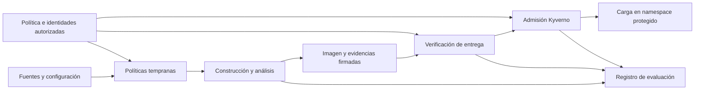
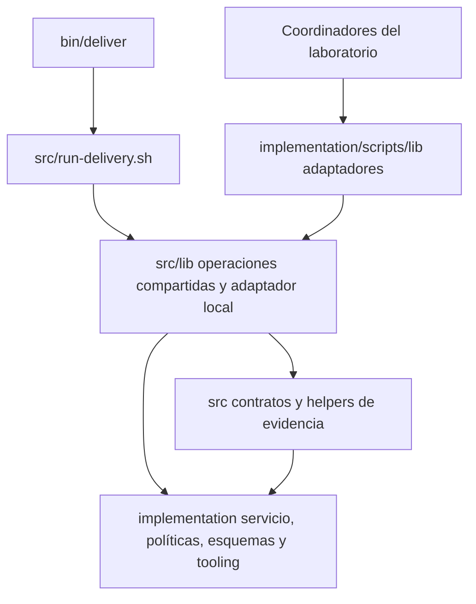

# Arquitectura modular del Golden Path

[Documentación en español](README.md)

[Guía principal en inglés](../EN/architecture.md). Este documento se conserva como apoyo en español; el código, los mensajes operativos y los identificadores de escenarios son comunes a ambos idiomas.

## Frontera entre entrega local y laboratorio

La entrega local disponible de quotes-node entra por `bin/deliver` y usa el motor
compartido en `src/`. Los coordinadores del laboratorio lo consumen mediante
adaptadores. Es una ruta separada, no todo el repositorio. Empieza por la
[guía operativa](../../../docs/ES/legitimate-delivery.md); la
[tabla y contrato de módulos](#organización-implementada-y-dependencias) explican
propiedad canónica, rutas internas y compatibilidad.

## Decisión de diseño y fundamento

Se adopta una **arquitectura modular de automatización, políticas y evidencias, con coordinadores separados para entrega y laboratorio**. La modularidad consiste en agrupar responsabilidades y definir cómo se comunican y prueban sus componentes. Makefile y los workflows invocan comandos comunes. `bin/deliver` coordina el motor extraído en `src/`; `scripts/demo.sh` coordina adaptadores del laboratorio en `scripts/lib/`, el mismo motor compartido y `tests/scenarios/`. Las políticas, validaciones y el empaquetado mantienen sus componentes especializados. La admisión vuelve a comprobar las condiciones aplicables antes de incorporar o actualizar una carga en el ámbito protegido de Kubernetes.

Esta denominación describe la organización elegida; no introduce un estándar arquitectónico nuevo. NIST SP 800-204D trata la integración de controles de cadena de suministro en las etapas de CI/CD. Tekton ofrece un ejemplo real de composición de tareas con entradas y salidas, mientras que Konflux separa la construcción de la verificación de atestaciones mediante políticas antes de liberar una imagen. Estos antecedentes fundamentan la separación de responsabilidades, sin exigir instalar esas plataformas en el laboratorio. [NIST SP 800-204D](https://csrc.nist.gov/pubs/sp/800/204/d/final), [Tekton: Tasks and Pipelines](https://tekton.dev/docs/pipelines/), [Konflux: Enterprise Contract](https://konflux-ci.dev/architecture/core/enterprise-contract/).

El criterio práctico es que una regla o verificación pueda comprenderse y probarse sin leer todo el workflow. La automatización coordina las herramientas existentes; las políticas expresan condiciones de aceptación y las evidencias permiten comprobar qué artefacto satisface esas condiciones. La separación facilita cambios acotados y pruebas por componente. La demostración de R y G conserva la misma API y la misma imagen, lo que permite estudiar el efecto funcional de los controles sin cambiar el servicio. Esta organización no demuestra por sí sola una reducción de tiempos o costes: esos resultados corresponden a la evaluación.

## Responsabilidades y límites

| Componente | Responsabilidad | Límite |
|---|---|---|
| Servicio `quotes-node` | Proporcionar una API sintética, determinista y comprobable para recorrer la entrega. Separar transporte HTTP, validación y lógica de cotización. | No representa un sistema asegurador real ni incorpora un modelo actuarial. |
| Orquestación | Ordenar tareas, trasladar parámetros y resultados, detener pasos protegidos y conservar evidencias. | `src/run-delivery.sh` coordina entrega y limpieza local; `demo.sh`, ejecución y limpieza del laboratorio. Cada ejecución tiene un único `trap` de limpieza y contexto compartido entre módulos. |
| Políticas tempranas | Comprobar configuraciones mediante Conftest y aplicar las condiciones del laboratorio a resultados del analizador. | Una configuración permitida no acredita la integridad posterior de la imagen. |
| Construcción y análisis | Construir la imagen, identificarla por digest y generar inventario e informe de vulnerabilidades mediante Trivy. | El informe debe corresponder al objeto que se entrega; reconstruir sin comprobar esa identidad no basta. |
| Evidencias y confianza | Generar, firmar, recuperar y verificar firmas y atestaciones; relacionar objeto, emisor, ejecución y política. | Una firma válida no garantiza por sí sola ausencia de vulnerabilidades o malware. |
| Admisión | Aplicar las políticas Kyverno sobre las operaciones pertinentes del namespace protegido y verificar las evidencias requeridas. | El resultado resumido no sustituye las comprobaciones directas acordadas. |
| Evaluación | Preparar escenarios, registrar observaciones y clasificar resultados según el protocolo. | No modificar la decisión de un control para producir un resultado favorable. |

Los seis bloques del catálogo clasifican propiedades evaluadas. No equivalen a seis microservicios ni a seis componentes desplegables: una comprobación sobre SBOM, por ejemplo, interviene en generación de evidencias, verificación y admisión.

## Recorrido y contratos verificables

Un **contrato** define la información que un componente entrega a otro y las condiciones que el consumidor debe comprobar. Incluye tanto el formato como su significado: un JSON bien formado con un digest ajeno no satisface el contrato de la imagen entregada.

La orquestación coordina el recorrido. Las flechas representan datos y dependencias de control; no obligan a ejecutar todas las tareas de forma estrictamente secuencial cuando sean independientes.

| Contrato | Información mínima y comprobación |
|---|---|
| Imagen | Referencia por digest y plataforma `linux/amd64`. Comprobar la correspondencia entre objeto analizado, firmado y desplegado; identificar índice OCI y manifiesto si aparecen ambos. |
| SBOM | CycloneDX JSON conservado como archivo original y como contenido de una atestación Cosign. La base comprueba campos mínimos, versión seleccionada, tipo esperado, firma y asociación con la imagen. CI valida el esquema oficial CycloneDX 1.7 antes de firmar y tras autenticar el bundle exacto; Kyverno comprueba campos seleccionados; su autenticidad no acredita la completitud del inventario. |
| Vulnerabilidades | Informe separado del SBOM, con objeto analizado, versión del analizador y base de datos identificables. Aplicar el bloqueo de HIGH o CRITICAL, exista o no corrección; conservar también el diagnóstico de análisis incompleto. |
| Firma de imagen | Verificar validez, correspondencia con el artefacto e identidad admitida. En la vía B comprobar emisor e identidad OIDC autorizados; en la vía A utilizar exclusivamente la confianza de desarrollo configurada. |
| Procedencia | Verificar firma e identidad autorizada, digest, repositorio fuente, commit y constructor o workflow requerido. Fijar la representación exacta durante la integración con Kyverno; generar procedencia no demuestra automáticamente un nivel SLSA. |
| Atestación de resultados | Predicado propio versionado, inspirado en VSA, con política identificada, origen, resultado y referencias a evidencias, vinculado al digest mediante la declaración in-toto. Emitir autorización satisfactoria solo si todos los controles obligatorios concluyen satisfactoriamente. Verificar autenticidad, tipo, versión, resultado y política exigida antes de aceptarla. |
| Decisión de un control | Distinguir aceptación, rechazo por una condición identificada y error que impide decidir. Conservar regla, causa e identificadores necesarios para atribuir la respuesta. Un control obligatorio con error detiene el paso protegido. |

La atestación de resultados utiliza un predicado propio versionado y no se presenta como implementación conforme de VSA. VSA sirve como referencia conceptual de una evaluación asociada a una política. Los [contratos de la entrega integrada](delivery-contracts.md) concretan el formato y las comprobaciones implementadas. [Especificación VSA](https://slsa.dev/verification_summary/v1).

Conftest utiliza políticas Rego y Kyverno utiliza sus propios recursos declarativos. Se comprobará la coherencia de las propiedades compartidas mediante entradas válidas e inválidas y expectativas comunes, adaptando la representación de cada entrada a su consumidor. No se presupone que ambos ejecuten el mismo archivo ni que toda regla temprana tenga una réplica en admisión. [Conftest](https://www.conftest.dev/), [Kyverno: verificación de imágenes](https://kyverno.io/docs/policy-types/cluster-policy/verify-images/).

## Dos vías de ejecución

La **vía A** ejecuta el laboratorio desde el devcontainer con kind, zot y firma de desarrollo. `make demo` invoca directamente `demo.sh`; `act` permite probar adicionalmente los pasos compatibles de los workflows. La **vía B**, con GitHub Actions, GHCR, OIDC real y firma keyless, está destinada a verificar la integración alojada y sus identidades. Los comandos de análisis y sus entradas se reutilizan cuando sea posible; la confianza, las credenciales y los mecanismos de publicación se configuran de forma diferenciada.

Una prueba local de la regla no acredita la integración de OIDC ni el comportamiento del servicio alojado. Los workflows están en **`.github/workflows/`, en la raíz del repositorio**, y referencian los componentes de `implementation/`. CI ejecuta las pruebas en PR y push; la integración de B es manual mediante `workflow_dispatch`. Todavía no se ha convertido en un workflow reutilizable mediante `workflow_call`. El [registro histórico de validación](../../registros/validacion_integracion.md) describe su alcance registrado; la [guía de ejecución](cases/L01-F13/runbook.md) distingue la sustitución de imagen alojada satisfactoria con perfil clásico del candidato bundle, cuya prueba local con recuperación estricta pasó. F07 dirigido local pasó después en `run-xFGRe6X1`; el [registro](../EN/cases/F07/record.md) conserva hashes y límites. F07 alojado sigue pendiente; la guía documenta las observaciones anteriores de OIDC/SCT/transparencia.

Las entradas del laboratorio son `make demo` y `make reference`; la entrega local ordinaria usa `bash bin/deliver local`. En GitHub se mantiene la secuencia **prepare → actions/attest → finish → cleanup**: la preparación produce la imagen inicial y la de sustitución L01 con estados separados; dos pasos de la acción alojada emiten procedencia nativa para sus respectivos digests. La finalización verifica cada entrega y la limpieza retira los recursos compartidos. No se sustituye la acción alojada por una función local.

## Organización implementada y dependencias

Las rutas parten de la raíz del repositorio. Son módulos en **un proceso Bash
por ejecución**, con variables y funciones compartidas; no servicios aislados ni
fronteras de seguridad. Los imports definen funciones sin crear recursos, usar
la red ni iniciar escenarios.

| Implementación canónica | Operaciones y frontera |
| --- | --- |
| [`bin/deliver`](../../../bin/deliver) → [`src/run-delivery.sh`](../../../src/run-delivery.sh) | Entrada pequeña → secuencia local fija, ejecución nueva y propietario único de limpieza/finalización. |
| [`src/lib/context.sh`](../../../src/lib/context.sh) | `context_init`, crear/cargar estado, `get`/`put`, capturar/revalidar fuente confirmada, registrar etapas y empaquetar. |
| [`src/lib/delivery.sh`](../../../src/lib/delivery.sh) | Pruebas de servicio/workflow, inputs del build, publicación/digest, manifiestos, SBOM original y análisis/política de vulnerabilidades. |
| [`src/lib/attestations.sh`](../../../src/lib/attestations.sh) | Confianza por carril, verificación separada de imagen/SBOM/procedencia, consulta fresca y autorización de resultados. Autenticar antes de aceptar campos. |
| [`src/lib/workload.sh`](../../../src/lib/workload.sh), [`admission.sh`](../../../src/lib/admission.sh) | `workload_deploy`, rollout, imagen efectiva y HTTP; clasificación estricta del diagnóstico de admisión. Salud y admisión son observaciones distintas. |
| [`src/lib/local-environment.sh`](../../../src/lib/local-environment.sh), [`local-delivery.sh`](../../../src/lib/local-delivery.sh) | Primitivas neutrales kind/zot/buildx, namespaces, `k`/`actor` restringido, readiness y diagnóstico; el adaptador `environment_*` añade capacidad, recibos inmutables y retirada. No importa `lab.sh`. |
| [Helpers de `src/`](../../../src/) | `contracts.mjs` genera/valida contenido; helpers bundle/GitHub interpretan contenido autenticado; captura de fuente/build, esquemas y escritura/verificación de archivos. Campos e inventario no autentican firmas. |
| [Adaptadores del laboratorio](../../scripts/lib/), [`demo.sh`](../../scripts/demo.sh) y [escenarios](../../tests/scenarios/) | Reutilizan el motor; conservan selección de fuentes/fixtures, referencia, mutaciones/readiness, hooks de medición/manuales y selección de limpieza/empaquetado. Las rutas antiguas delegan en helpers canónicos. |
| [Servicio](../../services/quotes-node/), [políticas](../../policies/), [esquemas](../../schemas/) y [tooling](../../tooling/) | Entradas bajo `implementation/`, junto a `versions.env` y `tools.lock.json`. El servicio no importa el motor. Conftest/Kyverno mantienen implementationes distintas. |

Las flechas indican dependencias. El producto no carga adaptadores del laboratorio.
`bash implementation/scripts/deliver.sh local`, su cleanup y
`make -C implementation deliver` llegan al mismo motor. El soporte histórico
[`complete-classic-chain.mjs`](../../scripts/complete-classic-chain.mjs) sigue
fuera de la ruta bundle activa. El [inventario](../../../docs/EN/maintainers/repository-map.md)
detalla consumidores e interfaces mixtas restantes.

### Contrato de módulos

1. **Inicializar.** El coordinador resuelve `root` a `implementation/`, cambia a
   ese directorio, fija `mode=local`, `phase`, `execution_profile=delivery-v1`,
   importa `versions.env` y carga `context`, `admission`, `local-environment`,
   `delivery`, `attestations`, `workload`, `local-delivery`, en ese orden.
   `context_init` exige `root` y `mode` válido, establece el CWD de implementación,
   deriva rutas y vacía el estado. Una ejecución nueva crea
   directorios de estado/privados; cleanup carga y valida su recibo existente.
   El coordinador del laboratorio carga sus adaptadores `context`, `lab`,
   `delivery`, `attestations`, `workload` y los escenarios antes de inicializar.
2. **Estado compartido.** Se requieren `mode`/`phase`, `state_dir`, `private`;
   `id`, `cluster`, `registry`, `builder`, `port_pid` identifican recursos propios.
   `image_repo`, `digest`, `image`, `repository`, `commit`, `sign_args`/`verify_args`
   vinculan imagen, fuente y confianza. Cargar coordenadas tras build o restauración;
   nunca reemplazar silenciosamente un digest o ejecución.
3. **Rutas derivadas.** `engine_root` es `src/`; `service_root` es
   `implementation/services/quotes-node`; `policies_root`, `schemas_root`,
   `tooling_root`, `evidence_root`, `private_root` apuntan al árbol fijo
   (`tooling_root` es `implementation/`, con pins y `tooling/`). Son rutas internas
   registradas en `delivery-config.json`, no una API para servicios, namespaces,
   registros o clústeres de producción arbitrarios. Varias operaciones requieren
   todavía el directorio de trabajo de implementación.
4. **Adaptadores y callbacks.** El laboratorio redefine
   `delivery_capture_build_inputs` y `delivery_snapshot_database`; este último
   devuelve explícitamente la ruta seleccionada (contrato siguiente).
   `local-environment.sh` llama al hook opcional `environment_record_container`
   y requiere `environment_readiness_probe` del laboratorio para ciclos distintos
   de `authorized` antes de instalar o aplicar políticas. La ruta local autorizada usa evidencia fresca y server dry-run
   real con actor restringido. `gp_observe` registra opcionalmente observaciones
   en fronteras de atestación. Son hooks internos, no un sistema de plugins;
   importa el orden de carga.
5. **Errores y propiedad.** Invocar directamente etapas protegidas con
   `set -Eeuo pipefail`; envolver una etapa completa en `if`, `!` o `||` puede
   suprimir `errexit`. Capturar el rechazo esperado en el comando externo.
   El coordinador de entrega posee el trap y llama a `environment_cleanup`;
   `demo.sh` posee trap y limpieza del laboratorio. Los subshells solo retiran
   sus recursos transitorios. Conservar primer fallo, diagnósticos y archivo;
   errores de limpieza/empaquetado no producen PASS. Véase [resultado final](../../../docs/ES/legitimate-delivery.md#inspeccionar-resultados-y-evidencias).
6. **Persistencia.** `get`/`put` usan el `state.json` seleccionado. Las variables
   no sobreviven entre procesos o pasos Actions: prepare/finish/cleanup alojados
   restauran estado e imagen explícitamente. Esto no permite reanudar entrega
   local. La captura incluye `bin/`/`src/`; no reescribe hashes históricos.

Las [pruebas de frontera](../../tests/unit/product-boundary.test.mjs) ejercitan
operaciones aisladas y compatibilidad; la [prueba real de sparse checkout](../../tests/integration/product-boundary.py)
y el [registro fechado](../../../docs/EN/maintainers/delivery-core-validation.md#p01b-implementation-boundary--4-november-2026)
vinculan independencia a revisiones exactas. Sustituir etapas prueba orden, no
integración. La confianza alojada requiere su ejecución autorizada.

**Contratos internos de adaptadores.** `delivery_snapshot_database SOURCE DESTINATION`
devuelve una sola ruta por stdout, diagnósticos por stderr y estado distinto de
cero ante fallos. El destino debe ser nuevo, también al reutilizar. Por defecto
copia DB y metadatos; solo el adaptador de laboratorio puede devolver SOURCE sin
copiar cuando `manual_execution_mode=scripted`, `GP_REUSE_VULNERABILITY_DB=1` y
`GP_VULNERABILITY_DB` es explícito. El llamador conserva bytes e identidad y
verifica antes de usar y después de escanear. Las copias parciales se conservan
como diagnóstico, nunca como autorización. La sustitución de comandos propaga
explícitamente fallos; no lee ni modifica variables locales del llamador.

`delivery_capture_build_inputs CONTEXT BASE COMMIT [AUTHORIZATION_FILE EXECUTION PROFILE]`
emite JSON `{context, base, commit, files}`; cada fichero contiene `path` relativo,
`mode` Git, `sha256` y `content` UTF-8. Los contextos ordinarios son relativos al
CWD de implementación; los exports autorizados usan su ruta explícita. BASE y
COMMIT identifican base y fuente; PROFILE distingue `delivery-v1` y `laboratory`.
El producto exige `services/quotes-node` sin argumentos de autorización. Fixtures,
manual y L05 permanecen en laboratorio. La captura comprueba selección e integridad
autorizada; los validadores existentes de fuente/contratos/provenance comprueban
fuente comprometida y claims firmados. `delivery_build` posee `build-inputs.json`;
el fallo detiene antes del build. No se añade esquema ni autenticación alternativos.
`contracts.mjs` mantiene CLI y exports; estos llamadores no justifican dividirlo.

Las entradas shell de laboratorio que calculan `root` desde su ubicación resuelven
primero el fichero con `realpath -e`; los directorios no resuelven enlaces de fichero.
Es inicialización de la entrada, no trabajo al importar módulos. Se mantiene la
validación estricta de raíz canónica. Cleanup histórico selecciona únicamente las
raíces originales exactas de evidencia/privados del estado; no mueve estado ni
permite reanudar entre revisiones.

El bootstrap pareado resuelve por separado la ruta del servicio en cada commit
Git inmutable, exige objetos tree para servicio y `src`, y compara los IDs de
`src`. Un cambio de nombre sin cambios de aplicación no basta. El informe compara
esos árboles y el archivo de warmup se exporta desde la raíz del repositorio,
conservando los bytes originales de aplicación/paquetes. Solo se superpone el
Dockerfile medido, con la misma base fijada y cachés R/G aisladas. No cambian la
revisión congelada ni el protocolo. Como la selección L05/release, contempla los
directorios históricos conocidos, sin crear configuración arbitraria de servicios.

Se mantienen imports y funciones compatibles, además del estado compartido aún
necesario. El siguiente paso acotado es la plantilla de consumidor independiente
tras revisión de estas interfaces.

### Cómo extender un escenario

`tests/scenarios/l01.sh` comprueba la entrega legítima y una sustitución posterior autorizada. La segunda imagen utiliza el mismo commit fuente y una etiqueta de construcción distinta, con evidencias propias bajo `L01-update/`; los módulos comunes de entrega y atestaciones realizan sus comprobaciones. Un subshell aísla el contexto de sustitución y retira su propio proceso de sondeo, mientras `demo.sh` conserva la responsabilidad de retirar la infraestructura. `check-image-rollout.mjs` registra los digests reales de los nuevos Pods en `L01-image-update.json`. Comprueba el mecanismo de sustitución, no una actualización funcional de la aplicación.

`f13.sh` comprueba el rechazo por ausencia de resultados antes de emitir la autorización. En modo local, `f07.sh` elimina después únicamente la firma independiente, atribuye el rechazo y restaura el artefacto original. L01 inicial utiliza ese mismo digest; la finalización F07 reutiliza el validador de Deployment/Pods tras superar las pruebas HTTP. Conserva el resultado intermedio. El modo alojado registra F07 como no ejecutado/pendiente. `f11.sh` comprueba el manifiesto privilegiado en la política temprana y, después de admitir la carga legítima, ensaya una actualización prohibida. Los recursos comunes y la emisión/verificación de evidencias siguen siendo responsabilidades de los módulos del laboratorio.

Para incorporar otro escenario:

1. Concretar en su ficha la entrada válida, la alteración, el resultado esperado y el diagnóstico que permitirá atribuirlo.
2. Añadir las funciones de preparación y comprobación en `tests/scenarios/`, sin efectos al importar el archivo. Reutilizar el contexto y las operaciones comunes.
3. Añadir el archivo a la lista de escenarios cargados por `demo.sh` e incorporar sus llamadas en la fase apropiada, respetando cuándo existe cada evidencia. Invocar cada etapa directamente: envolver una función completa en `if`, `!` o `||` puede desactivar la detención automática de Bash ante errores dentro de ella. Capturar el rechazo esperado en el comando concreto. No modificar una política ni sus identidades permitidas para forzar el resultado esperado.
4. Conservar evidencias de la preparación y la respuesta. Diferenciar rechazo del control, error de infraestructura y control no alcanzado; comprobar la contraparte legítima pertinente.
5. Revisar el efecto sobre los demás escenarios y ejecutar las pruebas apropiadas antes de registrar su resultado. Añadir funciones a la base no acredita que el escenario se haya ejecutado.

Las mutaciones pertenecen al escenario; las reglas pertenecen a los controles. Si un caso requiere una nueva capacidad del Golden Path, esa capacidad se implementa y revisa por separado, con su requisito y pruebas. La limpieza común sigue teniendo un único propietario.

## Capa visual para la defensa

La [demo visual opcional](defense/defense-demo.md) utiliza una CLI fina y un coordinador
Python de sesiones sobre los mismos módulos que sólo definen funciones. Gestiona
preparación, presupuesto, recibos inmutables y visor de lectura; `demo.sh` conserva
su trap de limpieza del laboratorio completo. No añade políticas de aceptación.
El observador optativo de atestaciones conserva copias en límites reales de
funciones y permanece inactivo en el uso normal. DEMO_VALID_ACCEPT no equivale
a L01 completo ni a una observación de campaña. `GP_VULNERABILITY_SNAPSHOT_ROOT`
sólo permite cambiar el destino de una nueva instantánea de base: conserva el
comportamiento predeterminado, las comprobaciones de identidad y los umbrales.

Las acciones web autenticadas opcionales se supervisan en
`scripts/defense-demo/actions.py`: admite solo los nombres existentes, invoca al
coordinador, recoge hijos propios y cierra recibos por comando; no decide políticas
ni escenarios. `server.py` conserva sesión vinculada y comprobaciones de origen,
cookie y CSRF. `coordinator.py` conserva preparación, fuente, plazos y recibos de
operación. Los IDs enlazan solicitudes con operaciones separadamente del resultado
de la presentación original; los archivos cerrados entran en el índice/export existente.

## Límites y evolución de la modularidad

Los módulos comparten contexto y orden dentro de cada ejecución. El coordinador
de entrega y el del laboratorio conservan sus propios traps; el producto no
importa adaptadores del laboratorio. El [contrato de módulos](#contrato-de-módulos)
explica el acoplamiento interno que aún requiere consolidación.

`src/contracts.mjs` agrupa generación, validación y acceso a archivos; URIs,
controles y versiones también aparecen en productores/consumidores. Cambiarlos
exige revisión coordinada y pruebas explícitas de coherencia; las pruebas actuales
no la garantizan por completo. El [incremento propuesto](../../TODO.md#next-implementation-increment)
no introduce una API genérica de configuración.

Cambiar Trivy o Kyverno requiere adaptar representación, confianza y atribución
del rechazo, y validarlas. Conftest/Kyverno no ejecutan una única regla portable.
En el servicio, `RequestError` incluye estado HTTP; separar ese mapeo podría ayudar
al uso fuera de HTTP. No se afirma una arquitectura plenamente hexagonal.
Introducir estructura adicional requiere una necesidad concreta, no carpetas vacías.

## Pruebas de contratos y relación con el catálogo

El catálogo contiene veinte escenarios de evaluación, no un límite de veinte pruebas automatizadas. Una propiedad declarada como obligatoria requiere pruebas unitarias o de integración aunque su variante no tenga un identificador independiente en la campaña.

Entre esas comprobaciones se incluyen identidad no autorizada, digest distinto, resultado no satisfactorio, tipo o versión de predicado inadmitidos, campo obligatorio ausente, error de recuperación y fallo del verificador. La clasificación debe separar un rechazo atribuible a la política de una indisponibilidad externa. Ambos pueden impedir desplegar, pero no son la misma observación de eficacia.

También se comprobarán el ámbito protegido, las operaciones CREATE y UPDATE pertinentes y las barreras posteriores mediante los ensayos dirigidos acordados. El piloto fijará formatos, entradas y motivos observables antes de la campaña. El capítulo de metodología y el anexo de evaluación del [repositorio de la memoria](https://github.com/tfm-goldenpath/golden-path) especifican la selección de escenarios y la interpretación de sus resultados. Al consolidar las fichas operativas se registrará la revisión documental utilizada.

## DDD y alternativas arquitectónicas

No se adopta Domain-Driven Design como método de diseño de este prototipo. DDD organiza un sistema alrededor de un modelo de dominio y sus límites; su utilización exigiría justificar ese modelo, no solo nombrar módulos. En este caso, las responsabilidades principales son de automatización y verificación de entregas. `quotes-node` sirve como vehículo experimental y su simplicidad no justifica introducir agregados, repositorios de dominio o varios servicios. [Microsoft: análisis de dominio y DDD](https://learn.microsoft.com/en-us/azure/architecture/microservices/model/domain-analysis).

Se mantendrá un vocabulario preciso —imagen, digest, identidad, evidencia, política, autorización y decisión— y responsabilidades separadas. DSRM organiza la investigación, TDD guía la construcción y la arquitectura modular estructura el artefacto: cumplen funciones distintas y compatibles.

Una arquitectura hexagonal podría ser útil si apareciese una aplicación propia con lógica de dominio estable y numerosos proveedores intercambiables. Una plataforma como Tekton/Konflux aportaría componentes específicos de construcción y liberación. Para el alcance actual se elige una integración más acotada sobre GitHub Actions y herramientas existentes, suficiente para separar y probar los contratos sin añadir esos subsistemas.

## F07 CI / L04

La barrera compartida de solo lectura `ci-verification-gate.mjs` recupera y
autentica evidencias actuales del registro. `attestations.sh` separa su emisión;
`f07.sh` controla la mutación/restauración local de la sustitución antes de
resultados. `l01.sh` comparte su ejecución de sustitución con L04 y registra
finalización tras despliegue y HTTP. `demo.sh` conserva secuencia global,
resultados y limpieza compartida. El modo explícito `ci-replacement` valida la
propiedad de padre/candidato sin relajar el perfil autorizado de admisión.
Consulta el [registro operativo](cases/L04/record.md).

## Comprobaciones F08 sobre el reemplazo

`tests/scenarios/f08.sh` gestiona alteración y recuperación locales antes de emitir
resultados y después de la autorización normal. El helper F08 reutiliza validadores
de propiedad y respaldo F07, publica nuevos digests OCI y prueba el aislamiento.
Su diagnóstico ECDSA apoya la atribución y no autoriza entregas. El gate compartido
sigue siendo de solo lectura; conserva datos del proceso verificador y clasifica
fallos como incidencias de integración. El escenario autentica por separado las
evidencias no alteradas. L01 enlaza la finalización con el mismo rollout/HTTP de
L04; `demo.sh` conserva la limpieza de infraestructura. Consulta el
[registro F08](cases/F08/record.md).

## Incremento F05 / F06 / L03

CI valida el esquema oficial CycloneDX 1.7 antes de firmar y tras autenticar el bundle exacto. Los requisitos del laboratorio y la asociación al digest siguen siendo controles separados. Kyverno comprueba campos seleccionados, no el esquema completo. L03 añade un componente real fijado a la imagen de sustitución; no demuestra completitud del inventario. Consulte el [procedimiento y límites](cases/F05-F06-L03/runbook.md).

## Procedencia y revisiones inmutables

`tests/scenarios/provenance.sh` coordina F09/F10 y su recuperación;
`provenance-scenario-evidence.mjs` reutiliza controles de propiedad, respaldo e
inventario. Firma el fixture antes de mutar, sin publicarlo en esa fase. El gate
productivo autentica lo recibido y distingue ausencia aislada de procedencia y
repositorio autenticado no autorizado; otros errores detienen la entrega.
CI y admisión exigen origen, revisión, tipo y constructor configurados.
`lab_apply_admission_policies` reutiliza el renderer sin reinstalar Kyverno. La instalación inicial evita reiniciar; las actualizaciones renuevan el controlador. `check-admission-controller.mjs` comprueba generación, ReplicaSet, Pods Ready y EndpointSlices. El gate lee logs por Pod y realiza un dry-run de servidor con el actor restringido; al instalar reutiliza el clasificador estricto de `f13.sh`. Este preflight no sustituye el escenario F13 ni cambia sus resultados esperados.

`l05.sh` realiza dos ejecuciones legítimas seleccionadas por `l05-source.mjs`, que
exporta blobs Git inmutables de un par ordenado en `main` con árboles de aplicación
distintos. Se comprueban hashes, pruebas propias y fuentes reales antes de construir.
Cada revisión tiene política exacta y evidencia nueva. La selección precede a la
infraestructura; las entregas L05 siguen a los ensayos existentes sin cambiar
políticas dentro de estos. Ver [guía](cases/F09-F10-L05/runbook.md). L05 hosted
requiere dos ejecuciones Actions reales, no dos checkouts en una ejecución.

## Familia de autorización de resultados

`tests/scenarios/results.sh` separa la preparación legítima P0 de su reproducción
y controla la restauración F13/F14. `results-evidence.mjs`, en esa misma carpeta,
reutiliza respaldo, aislamiento y mutación reversible del registro propio; la
familia de procedencia conserva el comportamiento compartido. La aceptación de
producción reside en `src/contracts.mjs`, CI fresco y el renderizador Kyverno.
P1 procede del código de confianza, no del predicado recibido. `l01.sh` ejecuta
los ensayos después de emitir resultados y conserva recuperación L01 del mismo
digest; `demo.sh` mantiene la limpieza compartida. Véase el [procedimiento](cases/F13-F14/runbook.md).
F13 previo a emisión y su clasificador compartido de readiness/admisión no cambian.

## Familia estática de workflows

`tests/scenarios/workflows.py` prepara F01/F02 inertes, fija resultados esperados
y conserva evidencia. `scripts/workflow-evaluation.py` invoca Conftest y clasifica
decisiones/errores; `policies/conftest/workflow.rego` define aceptación.
`make test-workflows`, incluido en `make test` y CI ordinario, no requiere contexto
de entrega ni clúster y no se añade a `demo.sh`. Sigue vigente el control de
workflows reales. Véase la [guía](cases/F01-F02/runbook.md).

## Familia de ejecución F11 / F12 / L06

`tests/scenarios/runtime.sh` coordina CREATE negativos antes de L01 y UPDATE de
plantilla después de L01, además de Pods aislados. `f11.sh` conserva el fixture
válido y la atribución de campos. `runtime-evidence.mjs` verifica los oráculos y
resuelve tags en lectura; no autoriza entregas. `delivery.sh` persiste `buildTag`
para finish. El clasificador conserva `quotes-node` por defecto; solo se explicita
el nombre de los Pods aislados. No cambian políticas, confianza ni privilegios.
L06 comparte CREATE de L01 y exige un UPDATE real de anotación antes del reemplazo
de imagen. Véase el [registro](cases/F11-F12-L06/record.md).

## Frontera de la familia de vulnerabilidades

`make vulnerabilities` invoca la fase local del coordinador existente.
`delivery.sh` prepara la base, genera el SBOM original, analiza y evalúa la política;
`vulnerability-evidence.mjs` comprueba asociación y aptitud para autorización.
El escenario conserva selección de fixtures, atribución, comparación y orden local.
La captura admite cuatro contextos fijados; el empaquetador conserva sus
subdirectorios explícitos. La base se conserva fuera de Git con su identidad en
el paquete. No se añade workflow ni escáner a Kyverno.
Véase [F03/F04/L02](cases/F03-F04-L02/runbook.md).

## Límite de medición de una entrega

El [runner R/G pareado](paired-rg-measurements.md) coordina módulos compartidos
mediante fases prepare/procedencia nativa/finish/cleanup, con una construcción
y entrega legítima independiente por brazo. No ejecuta el demo ni escenarios.
Pruebas del servicio y controles G se miden; regresiones completas, infraestructura,
cachés y readiness sin candidato se registran aparte. El demo conserva preflight
y readiness de resultados ausentes.

La identidad exacta de `paired-rg.yml` en main usa emisor GitHub, builder nativo
y controles de fuente existentes. R no produce evidencias G. El formato
`paired-rg-observation/v1` conserva tiempos monotónicos/UTC y observaciones
incompletas; los paquetes distinguen mediciones individuales de escenarios.
Instrumentación implementada; desarrollo y cuatro pares del piloto temporal
completados en la [revisión incorporada](paired-rg-pilot-review.md). Aceptación
humana pendiente.

La [extensión de campaña](paired-rg-campaign.md) conserva el coordinador y usa
`paired_campaign.py` para contratos de borrador, vinculación y autorización.
Un job del mismo workflow valida y conserva el plan y recibos de desarrollo en
fuente final; no tiene permisos de entrega/firma. El job de pares consume ese
control antes de crear infraestructura. El análisis conserva intentos y muestra
posiciones ausentes/duplicadas; no es un planificador entre runs ni un servicio
de aprobación humana.

## Procedimiento de tareas manuales

La [calibración en carril A](manual-task-calibration.md) usa
`scripts/manual-tasks.py` para órdenes de una tarea, planes conservados y límites
de procesos. `manual_tasks.py` mantiene los eventos versionados y sus cálculos.
`manual_task_reviews.py` conserva revisiones humanas separadas e inmutables,
vínculos a evidencia y reglas de elegibilidad, reutilizando el verificador de
paquetes. La CLI coordina bloqueos y exige seis selecciones revisadas elegibles
al congelar límites. Revisar historia no exige el código actual; ejecutar tareas
nuevas y congelar límites mantiene las comprobaciones estrictas de código y
configuración. Véase el [procedimiento de revisión](manual-task-review.md).
`demo.sh local manual` conserva la propiedad de la infraestructura; las funciones
de `tests/scenarios/manual-tasks.sh` componen los módulos compartidos. Los
oráculos de `manual-task-evidence.mjs` reutilizan los validadores existentes.

La preparación comprueba el fallo y la entrada legítima fuera del cronómetro.
Cada intento tiene laboratorio y entradas independientes, conservados hasta la
limpieza explícita. F03 construye los cuatro archivos capturados de la corrección,
con wrappers intactos y lock de dependencia fijado. F10 consume un artefacto
autorizado existente sin firmar ni reescribir procedencia. F11 cambia solo los
campos de privilegios declarados. Cada verificación conserva evidencia separada,
incluidas correcciones fallidas; el empaquetador excluye material privado.
Incluye `manual-operations/` del laboratorio y `operations/` y preparación del
controlador propietario. Comprueba propiedad y hashes de eventos; la evidencia
se copia intacta junto al recibo para conservar sus enlaces al exportarla.
El directorio final de la tarea conserva los eventos de limpieza registrados
después de la captura del paquete del laboratorio.
No cambia el protocolo temporal B ni demuestra cobertura negativa hosted o
resultados humanos.

## Evaluación de reparaciones mediante script

El [runner automatizado](automated-remediation.md) importa preparación, operaciones protegidas, finalización, recuperación y limpieza del controlador existente. Solo añade secuencia de seis posiciones y continuación en fases verificadas. `automated_repairs.py` contiene las tres transformaciones predefinidas; `automated_assessment.py` comprueba detección, finalización, integridad y tiempos conservados. No introduce otra ruta de entrega ni IA en ejecución. `demo.sh` conserva la propiedad de los recursos.

La identidad scripted figura en tareas, recibos y archivos; los esquemas manuales mantienen compatibilidad. Selección de calibración, preparación de mediciones y reutilización de límites rechazan automatización incluso después de una revisión humana. Originales y reparaciones usan el empaquetado seguro existente. Se añaden límites operativos y reutilización secuencial de la base canónica con comprobaciones de identidad intactas. Se aplaza la evaluación de esfuerzo humano; esta evidencia técnica provisional no cierra el piloto ni autoriza la campaña alojada separada.

El [espacio de presentación](defense/demo-workspace.md) separa el modelo de visualización
(`demo/model.js`) de la interacción DOM (`demo/app.js`). No decide aceptación:
las etiquetas proceden de recibos confirmados y metadatos fijos de operación.
El servidor calcula capacidades con las mismas precondiciones que POST; el
coordinador sigue comprobando la preparación sellada. El inventario local lee
metadatos permitidos y acotados, sin cambiar la sesión vinculada. Los hechos de
workflows se derivan del YAML capturado, también en snapshots antiguos. La
exportación incluye y hashea ambos módulos de representación separados de la
fuente de evidencia; las observaciones originales permanecen inmutables.

El mismo renderizador usa rutas hash con identificadores conocidos para demostración,
detalle y vistas de catálogo/workflows/sesiones. El detalle sustituye la comparación;
el estado de lectura se conserva separado del sondeo y de las acciones del coordinador.
Ninguna ruta cambia la sesión vinculada al servidor ni ejecuta comandos.

El recorrido técnico completo es un modelo de presentación en `demo/model.js`:
la correspondencia de fases procede del catálogo capturado de la sesión y el
orden de operaciones, de sus recibos. `app.js` gestiona rutas hash, detalles bajo
demanda e inspección de archivos. Los recibos globales usan números de secuencia
seguros, sin asignarles escenarios Fxx/Lxx. Las etiquetas de archivos heredados
comparan fuente/hash capturados; no acreditan otra verificación ni modifican evidencia.

El visor añade `observations.py`, importador exclusivo de CLI: captura metadatos GitHub y resúmenes publicados con hashes, de forma acotada y en un almacén de evidencia pública separado. No despacha workflows ni cambia acciones de sesión. La interfaz separa observaciones remotas, configuración y recibos locales de atestaciones; la exportación incluye originales con el manifiesto de integridad existente. Consulta la [guía canónica de defensa](defense/README.md).

El perfil [early-security](defense/early-security.md) reutiliza supervisor y coordinador mediante acciones de caso enumeradas. `early.py` gestiona preparación por caso y observaciones independientes; sus adaptadores llaman evaluadores de escenario existentes. `lab_create_registry_builder` extrae registro/builder de `lab_create` para preparar F03 sin kind. `delivery_scan_original_sbom` extrae análisis/asociación de `delivery_scan`: reutiliza la base congelada comprobada y no regenera el SBOM. No cambia políticas, confianza ni expectativas de escenarios.

## Extracción histórica de entrega

P03 introdujo el coordinador cuando la infraestructura todavía estaba en
`lab.sh`. Esa descripción corresponde a la [validación fechada](../../../docs/EN/maintainers/delivery-core-validation.md),
no a los imports actuales. El [contrato actual](#organización-implementada-y-dependencias)
usa `src/lib/local-environment.sh` y el adaptador de ciclo de vida; el antiguo
`deliver.sh` es una entrada de compatibilidad. Se conservan revisiones originales
e identidades de productor/workflow.

## Perfil de consumidor independiente

La ejecución `consumer-v1` utiliza los mismos módulos. Fuente, workflow, pruebas
y contexto de build proceden del repositorio Git del consumidor; motor, políticas,
esquemas y herramientas pertenecen al motor. Antes de autorizar se recomprueban
pin exacto y ambos snapshots confirmados. Procedencia y resultados firmados
contienen el vínculo exacto configurado `node-http-consumer/v1` o `java-http-consumer/v1`, verificado contra configuración
confiable de ejecución en CI y admisión. No cambian productores ni autorización
de laboratorio, `delivery-v1` o modo alojado. Véanse la
[guía del consumidor](../../../docs/ES/consumer-quickstart.md) y la
[validación exacta](../../../docs/EN/maintainers/independent-consumer-validation.md).

### Adaptador Java acotado

`src/consumer-profiles.mjs` selecciona solo dos perfiles fijos; Node sigue siendo
el predeterminado. `src/java-toolchain.json` fija builder/runtime. Java valida
POM/Docker fijos, captura main/test/recursos y excluye únicamente `target/` raíz,
coherente con Docker. Construye desde bytes capturados; recursos binarios usan
base64 explícito. `src/java-tests.py` ejecuta el contenedor acotado, retiene ID
inmutable y verifica propiedad en cleanup, también desde el coordinador tras una
interrupción. No monta credenciales ni socket Docker.

`src/java-test-reports.py` exige XML Surefire nuevo y proceso exitoso.
`java-tests.json` vincula log, informes, hashes de artefactos y toolchain; el campo
`unitTests` Java apunta a ese recibo y autorización recomprueba sus archivos. Node
conserva TAP/log. El POM fijado no constituye lock completo de transitivas. Runtime
no contiene bibliotecas de prueba; identidad, puerto, controles y 192 MiB siguen fijos.

La identidad DB Java añade schema 2 con objeto `java` de metadatos/hashes; la DB
principal conserva schema 1 para llamadas existentes. Descarga explícita en caché
nueva, snapshots preservados, updates desactivados y hashes antes/después impiden
cambios silenciosos. Snapshots grandes quedan fuera del paquete/Git; identidades
y comandos sí se incluyen, junto con XML de pruebas y sus hashes. Admisión compara
perfil/productor exactos, nunca acepta ambos indiscriminadamente. Consulte la
[validación real pendiente](../../../docs/EN/maintainers/java-consumer-validation.md)
y los [comandos](../../../docs/ES/java-consumer-quickstart.md).
